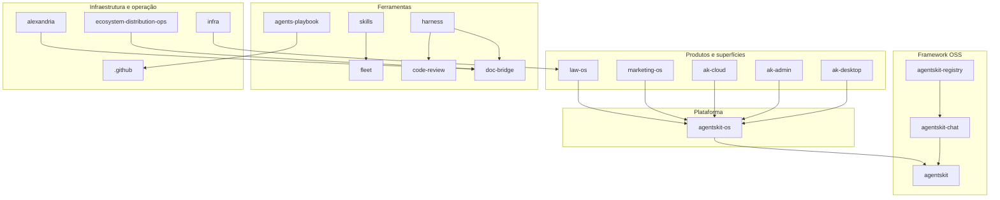

# 00 Hub - Ecossistema AgentsKit

> [!tldr] Em linguagem comum
> AgentsKit é um ecossistema para construir e operar trabalho com agentes de IA: o framework aberto fornece as peças básicas, a plataforma privada organiza execução, segurança e interface, os produtos aplicam essas peças a domínios como advocacia e marketing, e as ferramentas e a infraestrutura ajudam a equipe a desenvolver, documentar, distribuir e manter tudo.

O mapa agrupa o papel de leitura, não apenas a camada do frontmatter: ak-* são superfícies da plataforma, fleet é ferramenta de execução e Alexandria ainda é um serviço em preparação. As arestas detalhadas e seus limites estão em [[Mapa de dependências]].

## Os 19 repositórios

| Hub | Visibilidade | Camada | Em uma linha |
|---|---|---|---|
| [[00 Hub - .github]] | publico | infra | É a pasta de regras compartilhadas da organização no GitHub: oferece verificações de segurança reutilizáveis, um modelo de PR e a política de atualização de dependências. |
| [[00 Hub - agents-playbook]] | publico | docs | É o manual de engenharia do time: explica como trabalhar com agentes e oferece verificações prontas para que essas regras não dependam só de memória. |
| [[00 Hub - agentskit]] | publico | ferramenta | É a caixa de peças pública do ecossistema: permite montar agentes de IA, trocar provedores, usar ferramentas e memória e apresentar conversas em diferentes interfaces. Também hospeda os sites de documentação e Registry e o serviço Ask compartilhado. |
| [[00 Hub - agentskit-chat]] | publico | ferramenta | É a camada que transforma as peças do AgentsKit em uma aplicação de conversa consistente. A equipe define comportamento, ações e componentes uma vez e apresenta a experiência na Web, no celular ou no terminal. |
| [[00 Hub - agentskit-os]] | privado | plataforma | É a caixa de peças que transforma agentes de IA em um sistema operável: fluxos, aprovações, histórico, custos, segurança e telas. Law OS, Marketing OS e o desktop montam seus produtos com essas peças; o AgentsKit fornece os motores e integrações por baixo. |
| [[00 Hub - agentskit-registry]] | publico | ferramenta | É o catálogo público de agentes prontos para copiar e adaptar. Guarda código, metadados, testes e evidências; a vitrine fica no monorepo AgentsKit. Depois da instalação, o código pertence ao projeto que o copiou. |
| [[00 Hub - ak-admin]] | privado | plataforma | É a mesa de operação de quem fornece o AgentsKit para outras empresas: configura marca, permissões, catálogos e distribuição, e mantém um serviço que emite licenças assinadas. |
| [[00 Hub - ak-cloud]] | privado | plataforma | É a central hospedada que reconhece usuários e organizações, controla planos e gastos e oferece sincronização e APIs aos produtos. Não é o motor que executa os agentes: esse papel fica no [[os-headless]]. |
| [[00 Hub - ak-desktop]] | privado | plataforma | É o aplicativo instalado no computador para abrir o ambiente AgentsKit. A janela mostra a interface; um processo separado executa o backend e pode continuar trabalhando quando a janela é escondida. |
| [[00 Hub - alexandria]] | privado | produto | É a preparação de um serviço que cuidará da documentação de vários projetos: após mudanças, pretende propor correções em lotes. Hoje há lista de espera, um comparador determinístico e um webhook incompleto; o ciclo hospedado ainda não está ligado. |
| [[00 Hub - code-review]] | publico | ferramenta | Revê mudanças com IA e verifica as suspeitas antes de apresentar um parecer, por terminal ou GitHub Actions. |
| [[00 Hub - doc-bridge]] | publico | ferramenta | É o mapa que ajuda uma pessoa ou agente a encontrar onde mexer num projeto e como conferir a mudança. Também compara documentação com código e prepara correções para revisão; o núcleo funciona sem IA. |
| [[00 Hub - ecosystem-distribution-ops]] | privado | infra | É a mesa de operação que escolhe onde apresentar os produtos AgentsKit, prepara o material e registra o que aconteceu. Agentes podem pesquisar e sugerir; publicar ou enviar exige aprovação humana do conteúdo exato. |
| [[00 Hub - fleet]] | privado | infra | Máquinas privadas que executam tarefas de agentes para a equipe, preservando a revisão e a entrega no computador de quem pediu. |
| [[00 Hub - harness]] | publico | ferramenta | Organiza a esteira de desenvolvimento, da ideia à entrega, exigindo contrato, provas e decisões humanas onde a política pede. |
| [[00 Hub - infra]] | privado | infra | Mantém os recursos de nuvem compartilhados e dos produtos: endereços, proteção de acesso, arquivos e banco. |
| [[00 Hub - law-os]] | privado | produto | É o produto privado da AgentsKit para escritórios de advocacia: reúne casos, documentos e IA assistida, mas mantém o advogado responsável por aprovar o trabalho jurídico. |
| [[00 Hub - marketing-os]] | privado | produto | É a oficina editorial de uma equipe ou agência: reúne o jeito de falar de cada marca, propõe o calendário, ajuda a escrever e desenhar conteúdos e exige revisão antes do envio às redes pelo Buffer. Uma instalação atende um cliente e pode conter várias marcas, com pessoas e permissões diferentes. |
| [[00 Hub - skills]] | privado | ferramenta | Distribui os roteiros internos que ensinam os agentes a acompanhar entregas e usar a frota do time. |

## Por onde começar

| Quem chega | Caminho de leitura |
|---|---|
| Dev novo | [[Glossário]] → [[Mapa de dependências]] → hub do repo → pacote e fluxo → [[Infra e deploy]] |
| PM / produto | [[00 Hub - law-os]] / [[00 Hub - marketing-os]] → fluxos → [[Capacidades não usadas]] → [[Dúvidas abertas]] |
| Agente de IA | Leia AGENTS.md e CONVENTIONS.md → [[Mapa de dependências]] → fontes/commits da nota → execute refresh-brain e check-links antes de propor atualização |

## Mapas globais

| Nota | Para que serve |
|---|---|
| [[Glossário]] | Termos e siglas |
| [[Mapa de dependências]] | Relações e evidências |
| [[Infra e deploy]] | Hosts, distribuição e runners |
| [[Onde ficam os dados]] | Persistência e canais de segredos |
| [[Dúvidas abertas]] | O que ainda exige resposta |
| [[Capacidades não usadas]] | Limites, opções e ausência de chamador no escopo analisado |

> [!info]- Detalhe técnico
> Consolidado dos 19 hubs e materiais globais, nos commits registrados. O vault descreve código e configuração; não certifica deploy, adoção ou funcionamento dos produtos em produção.
