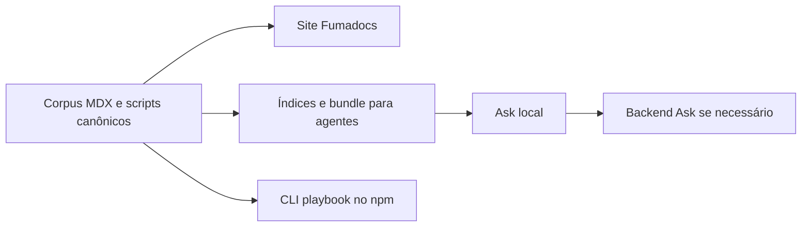

# 00 Hub - agents-playbook

> [!tldr] Em linguagem comum
> É o manual de engenharia do time: explica como trabalhar com agentes e oferece verificações prontas para que essas regras não dependam só de memória.

## Para que existe e quem usa

Repo **público**; site Next 15, React 19, Fumadocs, MDX, Tailwind e Node 22. Código MIT; corpus editorial CC BY 4.0. `private: true` no app raiz significa que ele não é publicado no npm, não que o repositório seja privado.

| App/pacote | Papel |
|---|---|
| [[agents-playbook-site]] | Site raiz, rotas humanas e para máquinas, Ask e artefatos |
| [[playbook]] | Único workspace de `packages/*`; CLI pública de gates |

## Fluxos

- [[Playbook - Do corpus à consulta]]
- [[Playbook - Da regra ao gate executável]]

## Como se liga ao ecossistema

| Vizinho | Relação |
|---|---|
| [[00 Hub - doc-bridge]] | Dependência de desenvolvimento para ownership e gates; Action de advisory |
| [[00 Hub - agentskit-chat]] | Adapter determinístico, protocolo de conhecimento, memória de sessão e Ask |
| [[00 Hub - agentskit]] | Core/React sustentam a interface conversacional |
| [[00 Hub - harness]] | Comandos de doctor/verificação do harness |
| [[00 Hub - .github]] | Reutiliza CodeQL, Scorecard, dependency-review e audit com SHA fixado |
| [[00 Hub - code-review]] e [[00 Hub - agentskit-registry]] | Referências editoriais no mapa do ecossistema; não implicam import de runtime |

## Dados, deploy e CI

Corpus em `content/docs`; bundle, índice raw, estatísticas e `public/deterministic` são derivados. O navegador usa memória de sessão fornecida por Chat; fallback aponta por padrão ao serviço Ask. Este repo não implementa o backend Ask e não declara banco próprio.

Wrangler/OpenNext configura Worker `agents-playbook` com assets, compatibilidade Node e teto de CPU de 5 s. Configuração Vercel permanece suportada; o checkout não confirma o destino ativo do domínio.

`ci.yml`: qualidade em `ubuntu-latest` (corpus, Doc Bridge, padrão README, testes, tipos/build e frescor dos gerados), browser Playwright e matriz de CLI/hooks em Linux/macOS/Windows. Os demais workflows são advisory documental e segurança compartilhada. Publicação npm não aparece como workflow dedicado neste checkout.

> [!info]- Detalhe técnico
> - `agents-playbook/README.md:1`.
> - `agents-playbook/package.json:2`.
> - `agents-playbook/pnpm-workspace.yaml:1`.
> - `agents-playbook/wrangler.jsonc:3`.
> - `agents-playbook/.github/workflows/ci.yml:17`.
> - `agents-playbook/.github/workflows/ci.yml:59`.
> - `agents-playbook/.github/workflows/codeql.yml:22`.
