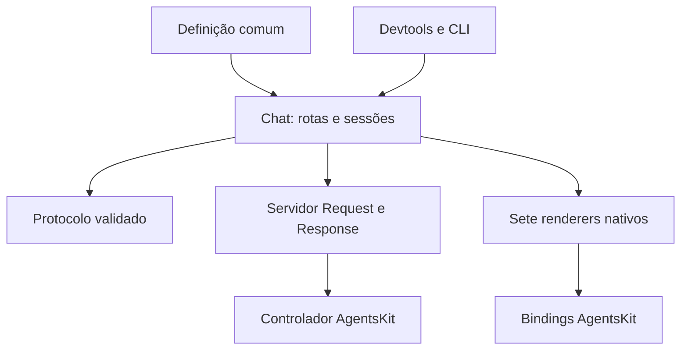

# agentskit-chat

> [!tldr] Em linguagem comum
> É a camada que transforma as peças do AgentsKit em uma aplicação de conversa consistente. A equipe define comportamento, ações e componentes uma vez e apresenta a experiência na Web, no celular ou no terminal.

## Para quem existe

É usado por equipes que precisam da mesma conversa em várias interfaces e pelos hosts Docs, Registry e Playbook. Ele compõe o controlador do framework; não mantém um segundo laço de ferramentas. Os exemplos compartilham cenários para tornar diferenças de comportamento visíveis.

**Visibilidade:** público/OSS (documentação pública e licença MIT; a configuração de visibilidade do GitHub não foi consultada). **Stack:** TypeScript estrito, pnpm, Zod, Vitest, Playwright e tsup; React, React Native/Expo, Ink, Vue, Svelte, Solid e Angular; documentação Next.js/Fumadocs.

## Peças do repositório

| Nota | Nome no manifesto / papel | Tipo |
|---|---|---|
| [[chat-angular]] | `@agentskit/chat-angular` | pacote |
| [[chat]] | `@agentskit/chat` | pacote |
| [[chat-cli]] | `@agentskit/chat-cli` | pacote |
| [[chat-devtools]] | `@agentskit/chat-devtools` | pacote |
| [[chat-ink]] | `@agentskit/chat-ink` | pacote |
| [[chat-protocol]] | `@agentskit/chat-protocol` | pacote |
| [[chat-react]] | `@agentskit/chat-react` | pacote |
| [[chat-react-native]] | `@agentskit/chat-react-native` | pacote |
| [[chat-server]] | `@agentskit/chat-server` | pacote |
| [[chat-solid]] | `@agentskit/chat-solid` | pacote |
| [[chat-svelte]] | `@agentskit/chat-svelte` | pacote |
| [[chat-vue]] | `@agentskit/chat-vue` | pacote |
| [[chat-docs]] | `@agentskit/chat-docs` | app |
| [[chat-example-ink]] | `@agentskit/chat-example-ink` | app |
| [[chat-example-react]] | `@agentskit/chat-example-react` | app |
| [[chat-example-react-native]] | `@agentskit/chat-example-react-native` | app |
| [[chat-example-shared]] | `@agentskit/chat-example-shared` | app |
| [[chat-example-solid]] | `@agentskit/chat-example-solid` | app |
| [[chat-example-svelte]] | `@agentskit/chat-example-svelte` | app |
| [[chat-example-vue]] | `@agentskit/chat-example-vue` | app |

## Fluxos principais

- [[AgentsChat - Resposta local e escalada]]
- [[AgentsChat - Sessão e retomada]]

## Ligações com o ecossistema

| Outra parte | Como se relaciona |
|---|---|
| [[00 Hub - agentskit]] | Fornece controlador, adaptadores, memória, ferramentas e bindings. |
| [[00 Hub - agentskit-registry]] | Fornece fontes e catálogo copiável. |
| [[00 Hub - agents-playbook]] | Guia de padrões; host de conversa e corpus Ask documentados. |
| [[00 Hub - doc-bridge]] | Indexação, handoffs e gates documentais configurados nos repositórios. |
| [[00 Hub - harness]] | Companheiro do ecossistema para o ciclo SDLC; não é runtime obrigatório de agentes. |
| [[00 Hub - code-review]] | Companheiro de revisão citado na documentação pública. |
| [[00 Hub - .github]] | Workflows compartilhados de segurança referenciados por agentskit e agentskit-chat. |

## Infra e deploy

A superfície npm declarada é composta por `@agentskit/chat` e `@agentskit/chat-cli`; protocolo, servidor, devtools e renderers são subpaths consolidados. O workflow `docs-deploy.yml` publica o site de docs via Vercel com verificação Playwright antes da promoção. Também há configuração OpenNext/Cloudflare Workers em `apps/docs/wrangler.jsonc`; isso é um caminho disponível, não prova do host atual. Stores e provedores são injetados; o subpath drizzle-pg oferece persistência PostgreSQL, sem obrigar Neon.

## CI: o que está configurado

| Workflow | Runner declarado | Responsabilidade legível no código |
|---|---|---|
| `ci.yml` | `ubuntu-latest` | Lint, build, testes e gates documentais; condições podem selecionar subconjuntos. |
| `codeql.yml` | Delegado ao workflow reutilizável; runner não declarado localmente. | Workflow especializado: codeql. |
| `dependency-review.yml` | Delegado ao workflow reutilizável; runner não declarado localmente. | Workflow especializado: dependency-review. |
| `doc-bridge-advisory.yml` | `ubuntu-latest` | Workflow especializado: doc-bridge-advisory. |
| `docs-deploy.yml` | `ubuntu-latest` | Deploy do site e verificação antes da promoção. |
| `release-alpha.yml` | `ubuntu-latest` | Publicação/versionamento e verificações de artefatos. |
| `release.yml` | `ubuntu-latest` | Publicação/versionamento e verificações de artefatos. |
| `scorecard.yml` | Delegado ao workflow reutilizável; runner não declarado localmente. | Workflow especializado: scorecard. |

Esta tabela descreve configuração versionada, sem executar CI ou afirmar que o último run passou. Os comandos dos projetos não foram executados, conforme o contrato de análise estática.

> [!info]- Detalhe técnico
> - `agentskit-chat/README.md:1` — fronteira e superfície pública
> - `agentskit-chat/pnpm-workspace.yaml:1` — workspaces
> - `agentskit-chat/packages/chat/package.json:1` — subpaths consolidados
> - `agentskit-chat/scripts/assemble-chat-package.mjs:7` — montagem dos sete renderers
> - `agentskit-chat/packages/server/src/index.ts:96` — handler e autenticação opcional
> - `agentskit-chat/docs/architecture/overview.md:1` — responsabilidades
> - `agentskit-chat/apps/docs/wrangler.jsonc:1` — alternativa Workers
> - `agentskit-chat/.github/workflows/ci.yml:1` — workflow listado acima.
> - `agentskit-chat/.github/workflows/codeql.yml:1` — workflow listado acima.
> - `agentskit-chat/.github/workflows/dependency-review.yml:1` — workflow listado acima.
> - `agentskit-chat/.github/workflows/doc-bridge-advisory.yml:1` — workflow listado acima.
> - `agentskit-chat/.github/workflows/docs-deploy.yml:1` — workflow listado acima.
> - `agentskit-chat/.github/workflows/release-alpha.yml:1` — workflow listado acima.
> - `agentskit-chat/.github/workflows/release.yml:1` — workflow listado acima.
> - `agentskit-chat/.github/workflows/scorecard.yml:1` — workflow listado acima.

## Divergências e limites

Há 12 workspaces de pacote e 8 apps, mas dois pacotes públicos. `assemble-chat-package.mjs` e os exports explicam a consolidação. O guia de arquitetura ainda chama o primeiro servidor de `@agentskit/chat-server`; o manifesto atual publica essa API por `@agentskit/chat/server`. Autenticação no handler genérico é opcional no código; cabe ao host configurá-la, enquanto o AskService tem contrato de autenticação obrigatório.

Dúvidas, relações brutas e capacidades opcionais estão em [[Dúvidas abertas]] e [[Capacidades não usadas]] desta pasta.
