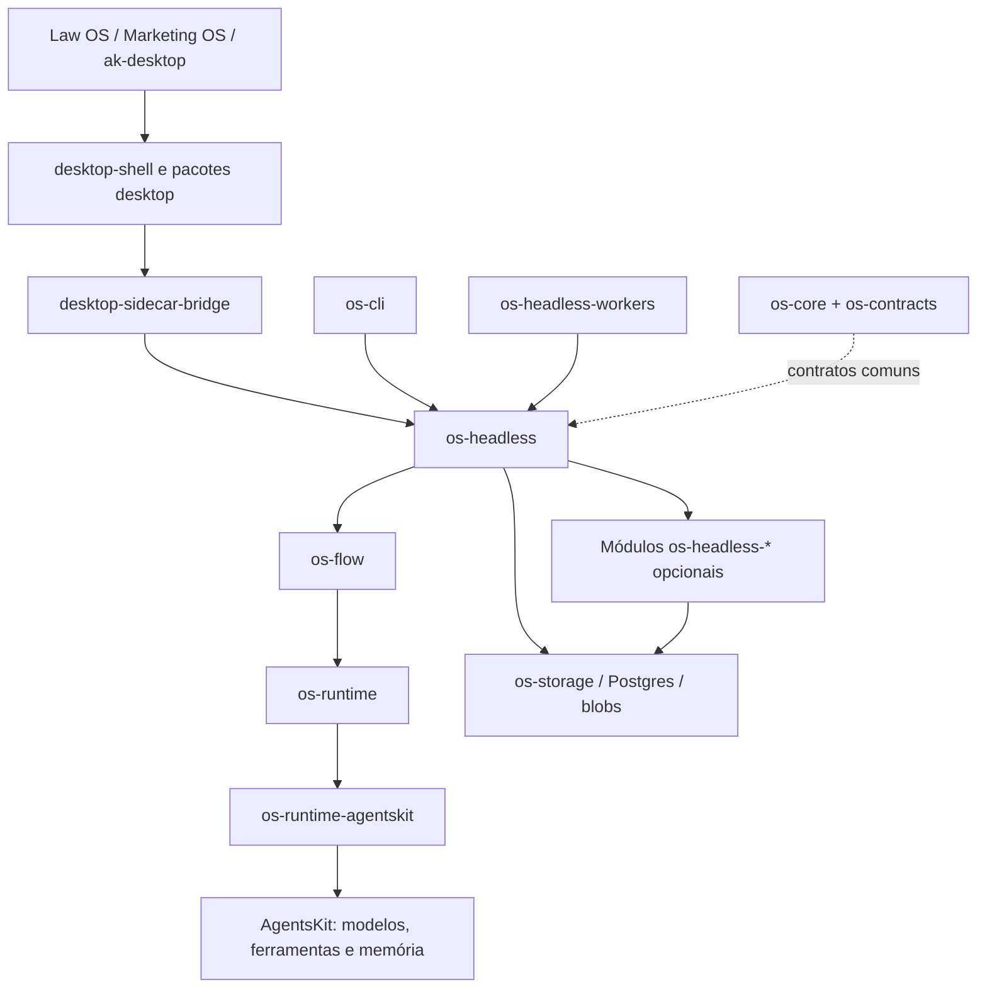

# agentskit-os

> [!tldr] Em linguagem comum
> É a caixa de peças que transforma agentes de IA em um sistema operável: fluxos, aprovações, histórico, custos, segurança e telas. Law OS, Marketing OS e o desktop montam seus produtos com essas peças; o AgentsKit fornece os motores e integrações por baixo.

## Para quem existe

| Quem | Uso |
|---|---|
| [[00 Hub - law-os]] | Produto jurídico; consome runtime, contratos e interface publicados em versões compatíveis |
| [[00 Hub - marketing-os]] | Produto de marketing; compõe campanhas, aprovação e automação sobre o servidor |
| [[00 Hub - ak-desktop]] | Janela Tauri e distribuição instalável, montadas com os pacotes React e o sidecar |
| [[00 Hub - ak-cloud]] | Identidade, controle e serviços hospedados que usam as portas da plataforma |
| [[00 Hub - ak-admin]] | Operação OEM, licença e configuração por cliente |
| Equipe de plataforma | Mantém contratos e versões compatíveis para esses consumidores |
| [[00 Hub - agentskit]] | Fornece adapters, ferramentas, memória e outras primitivas; o OS compõe em vez de duplicar |

**Visibilidade:** privado (GitHub, `gh repo view --json visibility`, 2026-10-16); o repositório declara licença proprietária/comercial. `private: true` no manifest raiz impede publicar a raiz e não significa que os pacotes internos não sejam distribuídos. O tier de compatibilidade usa o escopo `@agentskit-io` no GitHub Packages.

**Stack:** TypeScript, Node >=22, pnpm 10.33.0 e Turborepo; Zod nos contratos; React nos pacotes de interface; SQLite/better-sqlite3 local, Postgres/pgvector hospedado; Hono e Durable Objects na entrada Workers. Tauri pertence ao repo do desktop.

## Fluxos principais

| Caminho | Explicação |
|---|---|
| [[AKOS - Executar e retomar um fluxo]] | Configuração → passos → pausa humana → retomada e resultado |
| [[AKOS - Instalar conteúdo de um pack]] | YAML → validação → materialização nos stores → execução posterior |
| [[AKOS - Indexar e consultar conhecimento]] | Fonte → trechos → vetores → busca com escopo |
| [[AKOS - Compor e servir uma instalação]] | Host Node ou Workers → stores → módulos → RPC e eventos |

## Inventário conferido

São **102 pacotes em `packages/` e 10 workspaces de testes declarados**, sem `apps/`. A suíte `tests/chaos` possui manifest, mas não é workspace declarado no `pnpm-workspace.yaml`; fica fora da contagem e tem seu workflow descrito na CI.

| Pacote / workspace | Para que serve |
|---|---|
| [[agent-contracts]] | É a lista de formatos que as respostas dos agentes precisam respeitar. Confere o JSON antes que uma resposta da IA vire dado de negócio. |
| [[desktop-agent-workspace]] | É a base da área de trabalho dos agentes: fornece tradução, contexto do produto, revisão de contratos e um registro onde outros módulos encaixam suas telas. |
| [[desktop-agent-workspace-command-palette]] | Liga os comandos das telas de agentes à busca rápida do aplicativo. Um produto pode deixar essa peça de fora sem carregar a paleta inteira. |
| [[desktop-agent-workspace-copilot]] | É a conversa com o assistente na área de trabalho: painel de chat, sessões, configuração e tela do copilot. |
| [[desktop-agent-workspace-onboarding]] | Guia a primeira utilização do desktop e guarda o progresso dessa apresentação para cada identidade atendida. |
| [[desktop-components]] | Reúne peças de interface maiores e reutilizáveis, como painéis e visualizadores, para que as telas dos produtos tenham o mesmo comportamento. |
| [[desktop-data-infra]] | Mostra os dados do trabalho realizado: execuções, arquivos produzidos, auditoria e fontes de conhecimento. |
| [[desktop-operations]] | Reúne as telas da operação diária: conexões, catálogo de extensões, caixa de aprovações e ferramentas. |
| [[desktop-platform-admin]] | Reúne as telas de administração da plataforma: custos, segurança, observação, governança, configuração e pipelines. |
| [[desktop-shell]] | É a porta de entrada para montar o aplicativo compartilhado. Reexporta a composição do os-desktop e permite ao hospedeiro declarar quais recursos nativos oferece. |
| [[desktop-sidecar-bridge]] | É a ponte entre as telas e o servidor. Leva pedidos e eventos sem cada tela precisar conhecer HTTP ou a comunicação nativa do Tauri. |
| [[desktop-test-setup]] | Fornece substitutos de recursos do navegador para testes de componentes. Evita que cada pacote mantenha sua própria cópia dessas adaptações. |
| [[desktop-workflow-builder]] | São as telas para desenhar fluxos, escolher modelos e configurar os eventos que disparam uma execução. |
| [[os-audit]] | Monta lotes de auditoria encadeados e assinados, para que seja possível detectar alterações no histórico. Não deve ser confundido com toda e qualquer trilha do servidor. |
| [[os-blob]] | Guarda arquivos no disco por uma interface comum. O restante do sistema pode trocar o disco por armazenamento remoto sem mudar o contrato. |
| [[os-blob-s3]] | Guarda e busca arquivos em armazenamento compatível com S3, incluindo links temporários para acesso ao arquivo. |
| [[os-bot-signal]] | Define como pedir uma avaliação de risco de robôs ou endereços de rede. A implementação padrão não consulta fornecedor algum. |
| [[os-capabilities]] | Traduz o que uma pessoa quer fazer em capacidades, pré-requisitos e um plano de configuração, com registro da origem dessas recomendações. |
| [[os-cdc]] | Acompanha alterações em bancos Postgres e MySQL e as transforma em disparos de fluxo, mantendo uma marca do que já foi lido. |
| [[os-cli]] | É a entrada pelo terminal para criar, diagnosticar e operar um workspace. Encaminha operações ao servidor em vez de duplicar seu funcionamento. |
| [[os-cloud-sync]] | Reúne regras de sincronização, links de compartilhamento e cliente do cofre remoto. O hospedeiro fornece a persistência durável. |
| [[os-coding-agents]] | Conecta agentes de programação, como Codex e Claude Code, a um contrato comum de execução, com limites de diretório e preparação do ambiente. |
| [[os-collab]] | Reúne regras de equipe, permissões, presença e sincronização de documentos para colaboração entre pessoas. |
| [[os-command-palette]] | É a busca rápida do servidor: procura agentes, fluxos e outros objetos e ordena os comandos que a interface pode oferecer. |
| [[os-connectors]] | São os remetentes concretos para enviar mensagens ou ações a Slack, Discord, email, webhooks, GitHub e Linear. |
| [[os-contracts]] | É o catálogo das chamadas que clientes e servidor entendem. Define os parâmetros, resultados e erros de cada operação, sem ser o servidor que a executa. |
| [[os-control-plane]] | Resolve quem é a pessoa, a qual organização pertence e o que a licença e o plano permitem, combinando fontes locais e remotas. |
| [[os-copilot]] | É o motor da conversa com o assistente. Organiza contexto, ferramentas e propostas que podem precisar da decisão de uma pessoa. |
| [[os-core]] | É o vocabulário comum da plataforma: configuração, eventos, identidade, permissões, erros e contratos para serviços substituíveis. |
| [[os-cost]] | Contabiliza o uso, verifica orçamentos e políticas de gasto e decide se uma execução paga pode começar ou continuar. |
| [[os-desktop]] | É a implementação React do aplicativo compartilhado: junta provedores, navegação e telas. A janela nativa instalável fica em outro repositório. |
| [[os-dev-orchestrator]] | Prepara espaços de trabalho Git separados para tarefas de programação e organiza diferenças, relatórios e arquivos resultantes dessas tarefas. |
| [[os-egress-guard]] | Aplica a política de saída de rede por organização nos caminhos de execução hospedados, encaminhando decisões para auditoria. |
| [[os-email]] | Define a interface de envio de email e o catálogo de modelos. Traz uma saída de desenvolvimento pelo console, sem depender de um provedor de email. |
| [[os-email-resend]] | Liga o contrato comum de email ao serviço Resend e aos modelos React Email. |
| [[os-errors]] | Padroniza relatos de erro e oferece saídas vazia, console e remoção de campos pessoais antes do encaminhamento. |
| [[os-errors-sentry]] | Envia relatos de erro ao Sentry, com limpeza dos eventos e rastros antes da transmissão. |
| [[os-flags-posthog]] | Consulta no PostHog quais funcionalidades estão habilitadas. É a ligação do fornecedor com o contrato de flags da plataforma. |
| [[os-flow]] | É o maestro dos fluxos: confere o grafo, percorre os passos, pausa e retoma. Recebe de fora as funções que realmente executam cada tipo de passo. |
| [[os-for-agents]] | Transforma o catálogo de contratos em documentação consultável por agentes, incluindo catálogo estruturado e ferramentas de busca de documentação. |
| [[os-generative]] | Reúne operações para criar e variar agentes e extrair configurações de pedidos em linguagem comum. |
| [[os-headless]] | É o servidor sem interface gráfica. Junta configuração, execução, persistência e transportes, e recebe os módulos opcionais que cada produto escolhe ativar. |
| [[os-headless-cdc]] | Encaixa no servidor os observadores de mudanças em bancos, caixas de email e filas de arquivos, para disparar fluxos em segundo plano. |
| [[os-headless-cloud-sync]] | Encaixa no servidor as chamadas de sincronização com a nuvem, o cofre sincronizado e o estado operacional dessa conexão. |
| [[os-headless-cmdk]] | Encaixa no servidor a busca e a lista de comandos da paleta rápida. |
| [[os-headless-coding]] | Encaixa no servidor as chamadas para iniciar e acompanhar agentes de programação. |
| [[os-headless-connectors-domain]] | Encaixa os remetentes de serviços externos no servidor. Ter um conector instalado não significa que o produto autorize o envio. |
| [[os-headless-control-plane]] | Encaixa no servidor a resolução de identidade, organização e direitos, inclusive a fonte local para operação sem conexão. |
| [[os-headless-copilot]] | Encaixa no servidor as sessões do assistente, propostas, comandos de conversa e ações de criação de configuração. |
| [[os-headless-hosted-postgres]] | Monta o conjunto de armazenamento Postgres para execuções hospedadas, conectando os contratos do servidor aos bancos e à busca vetorial. |
| [[os-headless-knowledge]] | Encaixa no servidor o cadastro de documentos, a indexação e a busca de trechos relevantes, inclusive a ferramenta usada pelos fluxos. |
| [[os-headless-legal]] | Encaixa operações jurídicas no servidor genérico, como preparação da revisão de contratos, litígios e certificação de modelos. |
| [[os-headless-marketing-parts]] | Encaixa no servidor campanhas, briefings, rascunhos para Buffer, revisões e links de aprovação externa. |
| [[os-headless-marketplace]] | Encaixa no servidor a consulta, instalação e publicação de extensões, com chaves de publicadores e biblioteca privada. |
| [[os-headless-mcp]] | Encaixa no servidor conexões MCP e a ferramenta que permite a um fluxo chamar ferramentas desses servidores. |
| [[os-headless-notifications]] | Encaixa canais de notificação no servidor para encaminhar alertas de custo, operação e segurança. |
| [[os-headless-oem]] | Encaixa no servidor a personalização por revendedor e cliente: marca, pacotes, licenças e organizações. |
| [[os-headless-onboarding]] | Encaixa no servidor a aplicação de exemplos de primeira utilização, para o usuário começar com um conjunto coerente de dados. |
| [[os-headless-pipelines]] | Encaixa no servidor o motor de esteiras de trabalho, o acompanhamento do quadro e a conclusão de fases com decisão humana. |
| [[os-headless-seed]] | Carrega conteúdo inicial de pacotes para demonstração ou produção. Mantém explícita a diferença entre semear exemplos e preparar uma instalação real. |
| [[os-headless-templates]] | Encaixa no servidor o catálogo de modelos e receitas de processo, com os recursos de certificação dos modelos. |
| [[os-headless-webhook-server-parts]] | Recebe notificações assinadas de serviços externos e as encaminha para gatilhos e respostas de aprovação. |
| [[os-headless-workers]] | Permite hospedar o mesmo núcleo do servidor em Cloudflare Workers. Um Durable Object representa cada instalação e mantém seu estado. |
| [[os-headless-workspace-connectors]] | Lê diretórios, repositórios Git e cofres Obsidian Sync por uma interface com raízes permitidas e recusa de caminhos fora delas. |
| [[os-import]] | Converte configurações de outras ferramentas de agentes e automação para o formato comum da plataforma. |
| [[os-integrations]] | Traduz o catálogo de integrações do AgentsKit em ferramentas, remetentes, provedores OAuth e verificadores de webhook compreendidos pelo OS. |
| [[os-issue-tracker]] | Oferece uma interface única para ler e atualizar tarefas em GitHub ou Linear, com uma alternativa em memória para testes. |
| [[os-license]] | Assina e verifica licenças e calcula seu estado, limites de plano e período de tolerância. Não é o serviço de emissão hospedado. |
| [[os-log]] | Padroniza mensagens de diagnóstico no navegador e no servidor, com saídas substituíveis, histórico curto em memória e histórico no navegador. |
| [[os-marketplace]] | Empacota, verifica e publica extensões, além de fornecer a lógica do catálogo e do carregamento de plugins. |
| [[os-mcp-bridge]] | Descobre e conecta servidores MCP e traduz suas ferramentas para o formato que agentes e fluxos usam. |
| [[os-notifications]] | Decide quais avisos mostrar, como classificá-los e para onde encaminhá-los, mantendo preferências e um histórico curto. |
| [[os-oauth]] | Cuida do login delegado em provedores externos: autorização, retorno, troca, persistência, renovação e revogação de tokens. |
| [[os-observability]] | Transforma eventos de execução em registros, rastros e métricas que ajudam a entender o que ocorreu e identificar falhas. |
| [[os-oem]] | Aplica as regras de personalização por cliente e revendedor, verificando licenças, limites de assentos e instalação de pacotes de domínio. |
| [[os-onboarding-telemetry]] | Mede a primeira utilização usando somente sinais permitidos, contagens e durações, com agregação e proteção contra grupos pequenos. |
| [[os-otel-grafana]] | Liga a telemetria comum ao Grafana Cloud por exportadores OTLP de rastros, métricas e logs. |
| [[os-pdf]] | Transforma documentos estruturados em PDF com marca e seções. Quem chama decide onde guardar os bytes produzidos. |
| [[os-pipeline]] | Organiza esteiras com fases, agendamento, disparo, decisões e mudança de estado. Cada fase pode executar um fluxo, sem confundir esteira com o grafo do fluxo. |
| [[os-rag]] | Prepara e busca conhecimento: divide documentos em trechos, calcula representações numéricas e consulta os trechos mais relevantes. |
| [[os-rag-adapters]] | Fornece leitores de documentos, modelos de representação de texto e armazenamentos concretos para as interfaces de busca de conhecimento. |
| [[os-rag-pgvector]] | Guarda e busca os vetores dos documentos no Postgres com pgvector, aplicando o escopo necessário à consulta. |
| [[os-runtime]] | É quem sabe executar cada passo do fluxo: chamar IA, ferramenta, condição ou pessoa, acompanhando estado, erros e custo. |
| [[os-runtime-agentskit]] | Liga o executor do OS aos provedores, ferramentas e memória do AgentsKit. Concentra a integração concreta para o motor não depender de cada fornecedor. |
| [[os-sandbox]] | Escolhe ambientes de isolamento para ferramentas, com opções básicas e registro para implementações adicionais. |
| [[os-sandbox-vercel]] | Mede CPU e memória por execução e gerencia uma reserva de ambientes preparados por plano. Não substitui os mecanismos de isolamento do os-sandbox. |
| [[os-sealer-vault]] | Liga o chaveiro da plataforma ao HashiCorp Vault Transit para cifrar, decifrar e rotacionar chaves, mantendo o fornecedor isolado neste adaptador. |
| [[os-security]] | Reúne controles de segurança, como filtro de prompts, remoção de dados pessoais, permissões e exportações de conformidade. |
| [[os-statechart]] | Oferece máquinas de estados para controlar conversas e transições previsíveis sem espalhar regras por telas ou agentes. |
| [[os-storage]] | É a coleção de armazenamentos da plataforma: execuções, checkpoints, configurações e outros registros, com implementações locais e em memória. |
| [[os-store-postgres]] | Implementa o armazenamento relacional comum usando Postgres e isolamento por organização no banco. |
| [[os-telemetry]] | Inicializa a telemetria OpenTelemetry por um contrato comum; o destino dos dados é fornecido separadamente. |
| [[os-templates]] | É a galeria de agentes e fluxos prontos ou em preparação. Classifica a prontidão para evitar apresentar um exemplo incompleto como utilizável. |
| [[os-tenant-config]] | Guarda configurações por cliente com rascunho, publicação e retorno a uma versão anterior, preservando o histórico e a autoria. |
| [[os-triggers]] | É o catálogo dos eventos que podem disparar trabalho. Informa tipos e suporte; não mantém sozinho os observadores em execução. |
| [[os-ui]] | É o conjunto básico de componentes React e temas compartilhados pelas interfaces. As telas de produto constroem suas peças sobre essa base. |
| [[os-vault]] | Guarda segredos de forma cifrada e permite escolher chaveiro do sistema ou gerenciadores externos. Os consumidores recebem acesso pela interface comum. |
| [[os-vertical-store]] | Traduz os registros persistidos de setores de negócio para a interface tipada de personalização, sem duplicar essa tradução no servidor e no admin. |
| [[os-whitelabel]] | Lê e valida a personalização de um produto: marca, páginas, permissões, provedores e configuração por setor. |
| [[pack-fixtures-reference]] | Entrega arquivos YAML de referência para setores de negócio. São exemplos de conteúdo, não um motor de execução. |
| [[pack-loader]] | Lê pacotes YAML, confere seus formatos e referências e instala agentes, fluxos, esteiras e outros objetos nos armazenamentos recebidos. |
| [[pkw-test-fixtures]] | Reúne dados e executores determinísticos para os testes das esteiras, sem chamar serviços reais. |
| [[agentskit-os-e2e]] | É uma suíte de verificação do repositório, dedicada a jornadas completas. Não integra o produto distribuído. |
| [[agentskit-os-e2e-playwright]] | É uma suíte de verificação do repositório, dedicada a jornadas no navegador com Playwright. Não integra o produto distribuído. |
| [[agentskit-os-e2e-http-sidecar]] | É uma suíte de verificação do repositório, dedicada a contratos e jornadas pelo servidor HTTP. Não integra o produto distribuído. |
| [[agentskit-os-e2e-cli]] | É uma suíte de verificação do repositório, dedicada a uso real da linha de comando. Não integra o produto distribuído. |
| [[agentskit-os-storage-matrix]] | É uma suíte de verificação do repositório, dedicada a compatibilidade dos armazenamentos. Não integra o produto distribuído. |
| [[agentskit-os-pen-test-isolation]] | É uma suíte de verificação do repositório, dedicada a isolamento de organizações e execução. Não integra o produto distribuído. |
| [[agentskit-os-pen-test-scoped]] | É uma suíte de verificação do repositório, dedicada a ataques e limites de escopo. Não integra o produto distribuído. |
| [[agentskit-os-otel]] | É uma suíte de verificação do repositório, dedicada a integração da telemetria OpenTelemetry. Não integra o produto distribuído. |
| [[agentskit-os-infra]] | É uma suíte de verificação do repositório, dedicada a integração com serviços de infraestrutura. Não integra o produto distribuído. |
| [[agentskit-os-migrate-real]] | É uma suíte de verificação do repositório, dedicada a migração com bancos reais. Não integra o produto distribuído. |

## Publicação, deploy e dados

| Superfície | Implementação e limite da evidência |
|---|---|
| Pacotes de compatibilidade | GitHub Packages, versões fixas e BOM no consumidor; workflow `publish-law-os-compat-tier.yml`. Não foi consultada a publicação vigente no registry |
| Sidecar Node | Dockerfile do os-headless; workflow produz imagem no GHCR em Linux amd64. Deploy inclui exemplos Kubernetes; o produto pode hospedar em Railway |
| Entrada Workers | [[os-headless-workers]] usa Hono e um Durable Object por instalação, com bindings R2 e Hyperdrive/Postgres. O ADR-0194 descreve migração; presença do código não prova migração de todos os clientes |
| Dados locais | [[os-storage]] e [[os-vault]]; caminhos e drivers vêm do host. Banco, arquivos e chaveiro são responsabilidades distintas |
| Dados hospedados | [[os-headless-hosted-postgres]], [[os-store-postgres]], [[os-rag-pgvector]] e [[os-blob-s3]]; R2 também possui binding próprio na entrada Workers |
| Infra compartilhada | [[00 Hub - infra]] mantém a visão operacional; exemplos e ADRs deste repo não demonstram estado de um cluster |
| Registro de extensões | [[os-marketplace]] conversa com registros por interfaces próprias; [[00 Hub - agentskit-registry]] documenta o registro do ecossistema |

## CI: o que está configurado

Há **41 arquivos de workflow**. Configuração não é resultado: nenhum workflow foi disparado nem seu último status consultado nesta análise.

| Grupo | Workflows e propósito |
|---|---|
| PR e integração principal | `ci`, `ci-main`, `ci-min`, `mvp-ci-fast`, `required-checks-summary`, `whole-repo-test`, `reinforce`; checks, arquitetura, build e testes |
| Contratos e qualidade | `api-surface`, `honesty`, `size`, `perf-budget`, `mutation-test`, `visual-regression`, `code-review`, `security`, `security-pr` |
| Aceitação e isolamento | `e2e-pr-smoke`, `e2e-nightly`, `pen-test-scoped`, `kernel-egress-proof`, `storage-matrix`, `postgres-live-proof` |
| Serviços reais | `integration-otel`, `integration-services`, `integration-migrate-real`; dependem dos serviços definidos por cada job |
| Recorrentes e recuperação | `chaos`, `dr-drill`, `dr-rehearsal-quarterly`, `production-health`, `dogfood-golden-nightly`, `cold-walk-verticals-nightly`, `adr-behavioral-nightly`, `assistant-confidence-live`, `os-headless-coverage-nightly`, `flake-hunt` |
| Build/publicação e evidência | `build-sidecar-image`, `publish-law-os-compat-tier`, `cold-build-all-apps`, `pre-tag-cold-build`, `release-evidence-postmerge` |
| Runners | Predominantemente `blacksmith-2vcpu-ubuntu-2404`; `ci-min` e publicação do tier usam `[self-hosted, akos-local]`; `ci-cross-platform` usa `blacksmith-6vcpu-macos-latest` e `blacksmith-2vcpu-windows-2025` |

Os comandos raiz incluem `pnpm build`, `pnpm test`, `pnpm lint`, `pnpm verify` e checks de fronteiras, isolamento de fornecedores e contratos. Não foram executados: a tarefa autoriza somente análise estática e edição do vault.

## Divergências que importam

- O README ainda anuncia 70 pacotes e seis apps antes de dizer que não há apps. O inventário real é o da tabela acima; a extração do desktop é registrada na ADR-0191.
- `deploy/README.md` menciona build em pull request; o workflow atual tem `push` filtrado em main e `workflow_dispatch`, sem evento de PR.
- A descrição do [[os-collab]] ainda apresenta CRDT como futuro; sua entrada já exporta colaboração de documentos e gateway.
- [[pack-fixtures-reference]] menciona sete verticais no manifest; o diretório atual contém cinco setores e um `_template`, com o jurídico no produto separado.
- O vault importado descreve falha parcial da carga como rejeição de tudo; o `materialisePack` atual pode deixar linhas já gravadas e lança erro para não declarar instalação completa. Não há rollback global automático nessa função.
- ADR-0192 está marcado como proposto, mas já há composição pgvector no módulo de conhecimento e na entrada Workers. O estado formal do ADR e o código têm ritmos diferentes.

> [!info]- Detalhe técnico
> - `agentskit-os/README.md:237`.
> - `agentskit-os/pnpm-workspace.yaml:1`.
> - `agentskit-os/package.json:7`.
> - `agentskit-os/.github/workflows/build-sidecar-image.yml:16`.
> - `agentskit-os/.github/workflows/publish-law-os-compat-tier.yml:22`.
> - `agentskit-os/deploy/README.md:32`.
> - `agentskit-os/packages/os-headless-workers/src/bindings.ts:26`.
> - Decisão de arquitetura: `agentskit-os/docs/adr/0188-law-os-repository-extraction.md:1`.
> - Decisão de arquitetura: `agentskit-os/docs/adr/0189-github-packages-compatibility-tier-namespace.md:1`.
> - Decisão de arquitetura: `agentskit-os/docs/adr/0191-desktop-shell-repository-extraction.md:1`.
> - Decisão de arquitetura: `agentskit-os/docs/adr/0192-knowledge-pgvector-composition.md:1`.
> - Decisão de arquitetura: `agentskit-os/docs/adr/0194-headless-on-workers.md:1`.

## Dúvidas abertas

O estado das instalações, a política operacional de retenção e a publicação efetiva não são dedutíveis de código estático. Material para consolidação e perguntas estão em [[Dúvidas abertas]] e [[Capacidades não usadas]].
