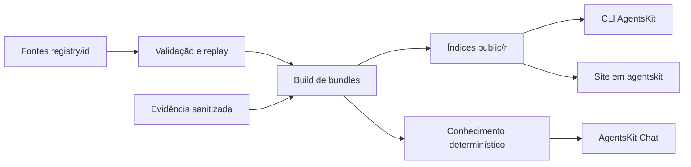

# agentskit-registry

> [!tldr] Em linguagem comum
> É o catálogo público de agentes prontos para copiar e adaptar. Guarda código, metadados, testes e evidências; a vitrine fica no monorepo AgentsKit. Depois da instalação, o código pertence ao projeto que o copiou.

## Para quem existe

Serve desenvolvedores que querem um ponto de partida editável, a vitrine Registry e ferramentas de descoberta. O CLI consome bundles; os agentes copiados passam a depender dos pacotes declarados em seus metadados, sem runtime Registry adicional.

**Visibilidade:** público/OSS (documentação pública e licença MIT; a configuração de visibilidade do GitHub não foi consultada). **Stack:** Repositório de dados e código TypeScript, scripts Node ESM, npm, Vitest e JSON. Não há apps/* ou packages/* declarados como workspaces; as notas abaixo descrevem módulos lógicos.

## Peças do repositório

| Nota | Nome no manifesto / papel | Tipo |
|---|---|---|
| [[registry-catalogo]] | Código e bundles de agentes | módulo lógico |
| [[registry-validacao]] | Estrutura, política de conteúdo e evidência | módulo lógico |
| [[registry-descoberta]] | Índices, conhecimento determinístico e llms | módulo lógico |

## Fluxos principais

- [[Registry - Da contribuição ao bundle]]
- [[Registry - Descoberta sem IA]]

## Ligações com o ecossistema

| Outra parte | Como se relaciona |
|---|---|
| [[00 Hub - agentskit]] | Fornece controlador, adaptadores, memória, ferramentas e bindings. |
| [[00 Hub - agentskit-chat]] | Fornece aplicação, protocolo e apresentação compartilhados. |
| [[00 Hub - agents-playbook]] | Guia de padrões; host de conversa e corpus Ask documentados. |
| [[00 Hub - doc-bridge]] | Indexação, handoffs e gates documentais configurados nos repositórios. |
| [[00 Hub - harness]] | Companheiro do ecossistema para o ciclo SDLC; não é runtime obrigatório de agentes. |
| [[00 Hub - code-review]] | Companheiro de revisão citado na documentação pública. |
| [[00 Hub - .github]] | Workflows compartilhados de segurança referenciados por agentskit e agentskit-chat. |

## Infra e deploy

Os artefatos versionados ficam em `public/r`, `public/deterministic` e arquivos llms. O site consumidor é [[agentskit-registry]] em [[00 Hub - agentskit]], com deploy Vercel documentado naquele repo. O build declara endereços públicos em registry.agentskit.io/r; o mecanismo que transporta estes dados até produção não está demonstrado por configuração de deploy deste repositório. Não há banco, Railway, Neon ou R2 obrigatórios para gerar o catálogo.

## CI: o que está configurado

| Workflow | Runner declarado | Responsabilidade legível no código |
|---|---|---|
| `ci.yml` | `ubuntu-latest` | Lint, build, testes e gates documentais; condições podem selecionar subconjuntos. |
| `codeql.yml` | `ubuntu-latest` | Workflow especializado: codeql. |
| `dependency-review.yml` | `ubuntu-latest` | Workflow especializado: dependency-review. |
| `scorecard.yml` | `ubuntu-latest` | Workflow especializado: scorecard. |

Esta tabela descreve configuração versionada, sem executar CI ou afirmar que o último run passou. Os comandos dos projetos não foram executados, conforme o contrato de análise estática.

> [!info]- Detalhe técnico
> - `agentskit-registry/README.md:1` — objetivo, contagens declaradas e propriedade do site
> - `agentskit-registry/docs/architecture.md:21` — limites de responsabilidade
> - `agentskit-registry/package.json:1` — build, validação, eval e testes
> - `agentskit-registry/scripts/build-registry.mjs:47` — geração de bundles
> - `agentskit-registry/scripts/build-discovery.mjs:13` — conhecimento local
> - `agentskit-registry/action.yml:15` — validação em outros repositórios
> - `agentskit-registry/.github/workflows/ci.yml:1` — workflow listado acima.
> - `agentskit-registry/.github/workflows/codeql.yml:1` — workflow listado acima.
> - `agentskit-registry/.github/workflows/dependency-review.yml:1` — workflow listado acima.
> - `agentskit-registry/.github/workflows/scorecard.yml:1` — workflow listado acima.

## Divergências e limites

“Validated” no catálogo reúne classificação/evidência versionada, não uma certificação para uso real. Os 346 agentes e 333 revisões são claims do README; a contagem estática do artefato é registrada no relatório deste lote. O README chama o artefato de “signed”; a implementação reutiliza hash de conteúdo, que não prova assinatura de autoria. O CLI pré-valida conflitos, mas não oferece rollback de falha de escrita, apesar do termo “transactional” usado no guia de arquitetura.

Dúvidas, relações brutas e capacidades opcionais estão em [[Dúvidas abertas]] e [[Capacidades não usadas]] desta pasta.
