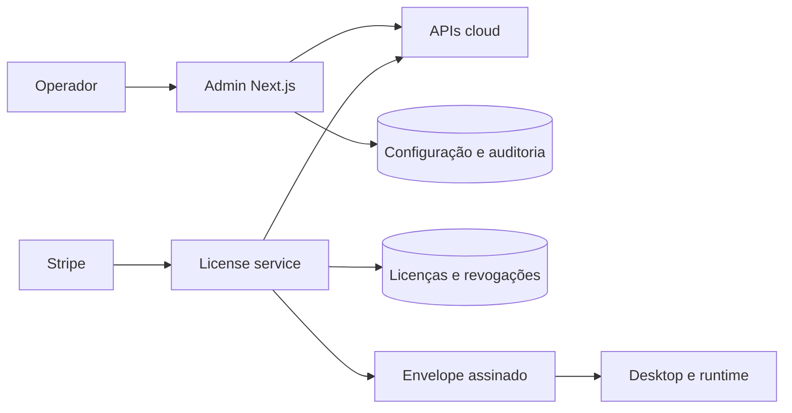

# 00 Hub - ak-admin

> [!tldr] Em linguagem comum
> É a mesa de operação de quem fornece o AgentsKit para outras empresas: configura marca, permissões, catálogos e distribuição, e mantém um serviço que emite licenças assinadas.

← [[00 Hub - ak-admin]]

## Para que existe e quem usa

| Quem | Relação |
|---|---|
| Operadores e OEMs | Administram organizações, marca, modelos, packs, membros, auditoria e conformidade |
| [[00 Hub - ak-cloud]] | Fonte de identidade, organizações, uso e catálogos acessada por clientes HTTP do admin |
| [[00 Hub - ak-desktop]] | Recebe distribuições OEM e verifica licenças com a plataforma |
| [[00 Hub - agentskit-os]] | Fornece [[os-tenant-config]], [[os-whitelabel]], [[os-license]] e demais bibliotecas |

**Visibilidade:** privado; apps internos. **Estado:** congelado no tier `0.1.0-rc.8`. **Stack:** Node 22, Next.js 15, React 19, TypeScript, Zod, Postgres, SQLite de fallback, Vitest e Playwright; license-service usa `node:http` e tsup.

## Apps e workspaces

| Nota | Papel |
|---|---|
| [[admin]] | Interface e ações de administração |
| [[license-service]] | Emissão, renovação, verificação e revogação |
| [[tests-admin-uat]] | Aceitação funcional das telas |
| [[tests-visual-regression-admin-d]] | Comparação visual desktop e tablet |
| [[tests-visual-regression-admin-m]] | Comparação visual mobile |

## Fluxos principais

| Fluxo | Resultado |
|---|---|
| [[ak-admin - Publicar configuração]] | Rascunho validado vira versão ativa auditada |
| [[ak-admin - Emitir e renovar licença]] | Envelope assinado, persistido e verificável |
| [[ak-admin - Distribuir OEM]] | Manifesto para build; caminho local é sintético |

## Infra e deploy

Admin é um servidor Next, porta local 3041; não foi encontrado Dockerfile dele. License-service tem Dockerfile Node e exige Postgres, aplicando migrações antes de ouvir. O host real (Railway, Kubernetes ou outro), banco gerenciado e domínio não são comprovados por estes arquivos. Dependências privadas vêm do GitHub Packages. O destino CDN de distribuição exige configuração explícita.

## CI

| Workflow | Runner / comportamento |
|---|---|
| `ci.yml` | `self-hosted, akos-local`: extração, instalação do tier e checks dos dois apps |
| `admin-uat.yml` | Blacksmith Ubuntu 24.04, manual/agendado, opt-in |
| `visual-regression-admin-d.yml` | Blacksmith; desktop/tablet, comparação e atualização de baselines conforme evento |
| `visual-regression-admin-m.yml` | Blacksmith; mobile, manual/agendado, opt-in |

Os três workflows de navegador dependem de `AKOS_OPTIONAL_CI_ENABLED`; não foi verificado o valor dessa variável nem um run atual. Material global e dúvidas em [[Dúvidas abertas]] e [[Capacidades não usadas]].

> [!info]- Detalhe técnico
> - `ak-admin/README.md:1`.
> - `ak-admin/pnpm-workspace.yaml:1`.
> - `ak-admin/apps/admin/package.json:1`.
> - `ak-admin/apps/license-service/package.json:1`.
> - `ak-admin/apps/license-service/bin/server.mjs:50`.
> - `ak-admin/.github/workflows/ci.yml:20`.
> - `ak-admin/.github/workflows/admin-uat.yml:23`.
