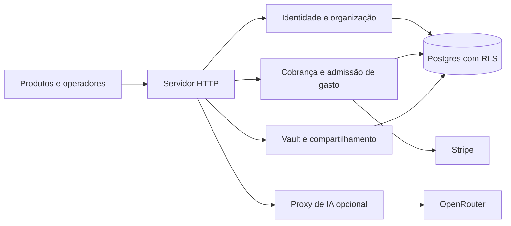

# 00 Hub - ak-cloud

> [!tldr] Em linguagem comum
> É a central hospedada que reconhece usuários e organizações, controla planos e gastos e oferece sincronização e APIs aos produtos. Não é o motor que executa os agentes: esse papel fica no [[os-headless]].

← [[00 Hub - ak-cloud]]

## Para que existe e quem usa

| Quem | Relação |
|---|---|
| [[00 Hub - law-os]] e [[00 Hub - marketing-os]] | Identidade, acesso inicial, uso e serviços de nuvem; a configuração de cada produto decide o que ligar |
| [[00 Hub - ak-admin]] | Provisiona organizações e consulta catálogos, membros, cobrança e políticas |
| [[00 Hub - ak-desktop]] | Cliente de serviços opcionais; o desktop pode trabalhar localmente sem sincronização |
| [[00 Hub - agentskit-os]] | Fornece os pacotes privados da plataforma; cloud os compõe em HTTP |

**Visibilidade:** privado, aplicação interna não publicada no npm. **Estado:** README congela o tier em `0.1.0-rc.8`. **Stack:** Node 22, TypeScript, `node:http`, tsup, Vitest, Postgres (`pg`), Stripe, SAML/OIDC, WebSocket e Redis opcional.

## Apps e suítes

| Nota | Papel |
|---|---|
| [[cloud]] | Único app de `apps/*`; central de serviços hospedados |
| [[tests-integration-scim-okta]] | Pacote de teste aninhado em `tests/integration/scim-okta`; não é app do produto nem workspace direto de `tests/*` |

## Fluxos principais

| Fluxo | Resultado |
|---|---|
| [[ak-cloud - Identidade e organização]] | Sessão verificada ligada a uma organização autorizada |
| [[ak-cloud - Cobrança e direitos]] | Evento Stripe conciliado com os direitos do plano |
| [[ak-cloud - Sincronizar vault]] | Snapshot criptografado guardado para o dono correto |
| [[ak-cloud - Autorizar execução paga]] | Reserva de orçamento antes do trabalho e conciliação depois |

## Infra e deploy

O repositório contém Dockerfile para o serviço Node e workflow manual que publica imagem de homologação Law no GHCR. Isso demonstra o caminho de empacotamento, não onde uma instância está rodando hoje. `DATABASE_URL` liga Postgres; migrações rodam antes de aceitar tráfego. R2/S3 é opcional para dados de uso, via [[os-blob-s3]]. Redis é opção do limitador. Sentry, PostHog e Resend têm integração condicionada a configuração. Não há evidência aqui para afirmar que Neon ou Cloudflare Workers hospedam este servidor.

## CI

| Workflow | Runner e escopo declarado |
|---|---|
| `ci.yml` | `self-hosted, akos-local`: extração, instalação do tier e checks do app; `ubuntu-latest`: admissão paga com Postgres real |
| `integration-scim-okta.yml` | Blacksmith Ubuntu 24.04; manual/agendado, condicionado a `AKOS_OPTIONAL_CI_ENABLED` e credenciais de teste |
| `publish-law-hml-image.yml` | `self-hosted, akos-local`; publicação manual de imagem GHCR |

A existência dos workflows não comprova execução recente. Dúvidas e material global estão em [[Dúvidas abertas]] e [[Capacidades não usadas]] desta pasta.

> [!info]- Detalhe técnico
> - `ak-cloud/README.md:1`.
> - `ak-cloud/pnpm-workspace.yaml:1`.
> - `ak-cloud/apps/cloud/package.json:1`.
> - `ak-cloud/apps/cloud/src/server.ts:103`.
> - `ak-cloud/apps/cloud/bin/server.mjs:152`.
> - `ak-cloud/.github/workflows/ci.yml:20`.
> - `ak-cloud/.github/workflows/publish-law-hml-image.yml:12`.
