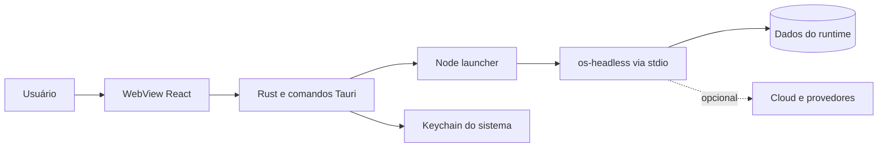

# 00 Hub - ak-desktop

> [!tldr] Em linguagem comum
> É o aplicativo instalado no computador para abrir o ambiente AgentsKit. A janela mostra a interface; um processo separado executa o backend e pode continuar trabalhando quando a janela é escondida.

← [[00 Hub - ak-desktop]]

## Para que existe e quem usa

| Quem | Relação |
|---|---|
| Usuário do aplicativo | Abre o workspace, acompanha e controla trabalho local |
| Equipe de distribuição/OEM | Gera instaladores e versões com outra marca |
| [[00 Hub - agentskit-os]] | Fornece [[desktop-shell]], [[os-desktop]] e [[os-headless]] em pacotes privados |
| [[00 Hub - ak-cloud]] | Serviços de nuvem opcionais |
| [[00 Hub - ak-admin]] | Configuração OEM e serviço de licenças; consumo automático de configuração não comprovado |
| [[00 Hub - agentskit]] e [[00 Hub - agentskit-chat]] | Dependências OSS `core` e chat usadas pelo app |

**Visibilidade:** privado. **Estado:** README congela tier `0.1.0-rc.8`. **Stack:** Tauri 2/Rust, React 19, Vite/TypeScript, Node sidecar, Vitest e Playwright. O repo não compila o código-fonte da plataforma: usa os pacotes publicados do tier.

## App e módulos

| Nota | Papel |
|---|---|
| [[desktop]] | Único workspace `apps/*`; boot React e composição |
| [[ak-desktop-native]] | Módulo Rust: janela, tray, RPC, keychain e verificador |
| [[ak-desktop-sidecar]] | Launcher Node do backend; não é workspace npm separado |

A raiz `ak-desktop/package.json` é orquestração de scripts, sem biblioteca de produto separada.

## Fluxos

| Fluxo | Resultado |
|---|---|
| [[ak-desktop - Abrir workspace]] | Backend alcançável e interface montada; diagnóstico se falhar |
| [[ak-desktop - Gerar distribuição]] | Bundle / release e variações OEM condicionados aos gates |

## Infra e distribuição

Roda no computador, não em Cloudflare ou Railway. O launcher embutido importa o sidecar publicado; o Rust procura `node` ou override configurado. Empacotar o launcher **não prova** que Node e todas as dependências estão distribuídos de modo autossuficiente. A configuração de updater tem endpoint de releases e placeholder de chave pública substituído no processo de release. GitHub Packages fornece o tier; workflows geram GitHub Releases, artefatos e attestations. Estado real do CDN/updater não inspecionado.

## CI

| Workflow | Runner / escopo |
|---|---|
| `ci.yml` | `self-hosted, akos-local`; gates web e build nativo sem assinatura |
| `release-gate.yml` | Mesmo runner; modo estrito e job que recusa gate não executado |
| `desktop-release.yml` | Gate opt-in e matriz macOS ARM/Intel, Ubuntu, Windows; tags `desktop-v*` |
| `oem-release.yml` | Validação no runner local e matriz de build; opt-in |
| `rebrand-build.yml` | Entrada manual, validação local e matriz de instaladores; opt-in |

`AKOS_OPTIONAL_CI_ENABLED` condiciona os caminhos opcionais. Nenhum workflow foi executado nesta análise. Dúvidas em [[Dúvidas abertas]] e [[Capacidades não usadas]].

> [!info]- Detalhe técnico
> - `ak-desktop/README.md:1`.
> - `ak-desktop/pnpm-workspace.yaml:1`.
> - `ak-desktop/package.json:1`.
> - `ak-desktop/apps/desktop/package.json:1`.
> - `ak-desktop/apps/desktop/src-tauri/tauri.conf.json:1`.
> - `ak-desktop/.github/workflows/ci.yml:21`.
> - `ak-desktop/.github/workflows/desktop-release.yml:19`.
