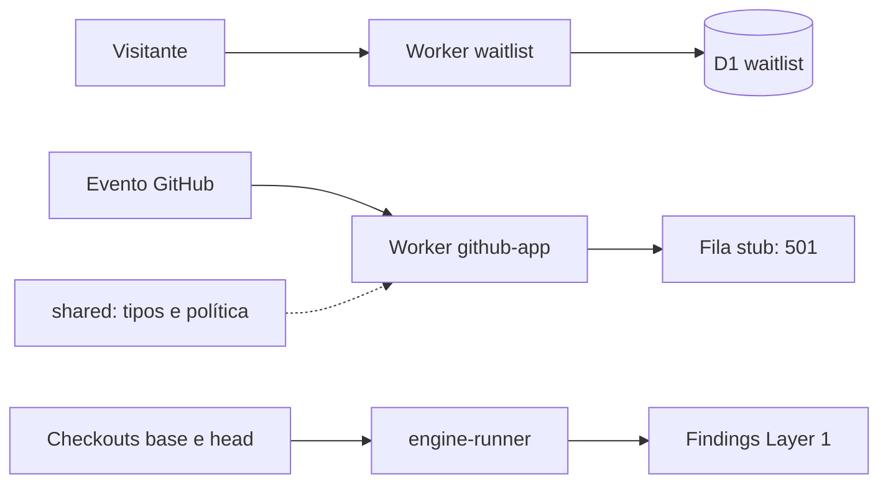

# 00 Hub - alexandria

> [!tldr] Em linguagem comum
> É a preparação de um serviço que cuidará da documentação de vários projetos: após mudanças, pretende propor correções em lotes. Hoje há lista de espera, um comparador determinístico e um webhook incompleto; o ciclo hospedado ainda não está ligado.

## Para que existe e quem usa

Repo **privado**, produto proprietário; licença/preço comercial adiados. Node ≥22, pnpm 11, TypeScript, Cloudflare Workers/D1, Vitest e Wrangler. O motor é [[00 Hub - doc-bridge]], público e independente do serviço.

| App/pacote | Estado no checkout |
|---|---|
| [[github-app]] | Webhook autentica assinatura; fila e integrações são stubs |
| [[engine-runner]] | Wrapper funcional da API pública doc-bridge 2.0.0 |
| [[alexandria-shared]] | Tipos e política de lote sem I/O |
| [[alexandria-waitlist]] | Worker e migrações D1; fora do workspace pnpm, validado pela raiz |

## Fluxos

- [[Alexandria - Inscrição na lista de espera]]
- [[Alexandria - Recepção do webhook até o limite atual]]
- [[Alexandria - Comparação determinística de revisões]]

## Relações e infraestrutura

| Vizinho/serviço | Relação |
|---|---|
| [[00 Hub - doc-bridge]] | `engine-runner` fixa versão 2.0.0; o upstream lido neste vault já está em 2.1.0 |
| [[00 Hub - agentskit]] | AGENTS orienta reutilizar capacidades genéricas; isso não prova que o runtime já as importe |
| Cloudflare Workers + D1 | Waitlist tem binding e migrações; database_id é placeholder |
| R2, Containers, D1 do produto | Plano do ADR-0001; bindings do webhook ainda não declarados |
| GitHub App | Endpoint autenticado e preparação via wizard, sem processamento hospedado completo |

O ADR-0001 adia MCP remoto, embeddings/Vectorize e sincronização entre repos. O ADR-0004 define BYOK com envelope encryption; não há implementação de custódia no scaffold. O wizard exige logins do mantenedor e não é executado em CI. Não foi verificado nenhum recurso remoto.

## CI e divergências documentais

`ci.yml`, runner `ubuntu-24.04`: instalação congelada, tipos, Vitest e `wrangler deploy --dry-run` dos dois Workers; **não faz deploy**. O README reconhece os diretórios implementados mas ainda rotula o status como preparação. `AGENTS.md` afirma que não há código nem comandos de verificação; isso está desatualizado diante dos fontes e scripts atuais.

> [!bug] Existe, mas ninguém usa
> O wrapper Layer 1 existe e tem teste, mas `github-app` injeta `unimplementedPorts.queue`, não o conecta ao runner. Registro de instalações, fila, publicação de lotes e custódia têm interfaces que rejeitam chamadas. Não há evidência de uma manutenção end-to-end hospedada neste commit.

> [!info]- Detalhe técnico
> - `alexandria/README.md:1`.
> - `alexandria/AGENTS.md:14`.
> - `alexandria/package.json:13`.
> - `alexandria/pnpm-workspace.yaml:1`.
> - `alexandria/apps/github-app/src/index.ts:7`.
> - `alexandria/apps/github-app/src/ports.ts:64`.
> - `alexandria/packages/engine-runner/src/index.ts:81`.
> - `alexandria/workers/waitlist/wrangler.toml:16`.
> - `alexandria/docs/adr/0001-phase-2-scope.md:23`.
> - `alexandria/docs/adr/0004-key-custody-envelope-encryption.md:17`.
> - `alexandria/.github/workflows/ci.yml:20`.
