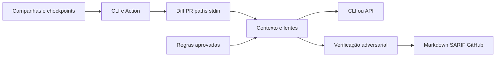

# 00 Hub - code-review

> [!tldr] Em linguagem comum
> Revê mudanças com IA e verifica as suspeitas antes de apresentar um parecer, por terminal ou GitHub Actions.

## Para que existe e quem usa

[[00 Hub - harness]] usa revisão; [[00 Hub - agentskit-registry]] fornece o agente vendorizado; [[00 Hub - agentskit]] fornece [[agentskit-adapters]], [[agentskit-core]] e [[agentskit-runtime]]. [[00 Hub - doc-bridge]] fornece gates documentais.

| Característica | O que está declarado |
|---|---|
| Visibilidade | Público; apps de docs são pacotes privados |
| Stack | TypeScript/Node 20+, AgentsKit adapters/runtime/tools, Zod, Action composta; docs Next.js/Fumadocs. |
| Consumidores | Equipe AgentsKit e integrações da tabela abaixo |

## Partes principais

| Pacote / aplicação / módulo | Papel |
|---|---|
| [[code-review-campaign]] | Coordena a revisão de vários pedidos de mudança sem perder o que já foi feito quando o processo reinicia. |
| [[code-review-docs]] | É o site que apresenta o produto e ajuda a escolher a configuração da revisão. |
| [[code-review-engine]] | É o revisor que lê mudanças, procura defeitos e tenta derrubar as próprias suspeitas antes de mostrá-las. |
| [[code-review-memory]] | Guarda aprendizados aprovados para reduzir erros repetidos sem transformar toda conversa com IA em memória permanente. |

| [[code-review-action]] | É a integração pronta para revisar um pull request dentro do GitHub Actions e publicar o parecer. |

## Fluxos principais

| Fluxo | Resultado |
|---|---|
| [[Code Review - Da mudança ao parecer]] | O código alterado é analisado por IA, as suspeitas são verificadas e o resultado pode bloquear o CI ou sair como recomendação. |
| [[Code Review - Retomar campanha e aprender]] | Uma campanha salva o andamento de cada PR e mantém aprendizados separados da execução, para poder retomar com segurança. |

## Deploy e dados

CLI local ou CI; provedor pode ser CLI autenticada, API, modelo local ou gateway. Site tem scripts de export/deploy Cloudflare; esta análise não consultou produção.

## CI e verificações declaradas

ci.yml roda checks em Ubuntu; release.yml prepara versão por Changesets; publish.yml valida e publica npm via OIDC. Há CodeQL, dependency-review e scorecard com workflows reutilizáveis/permissões próprios.

## Limites e divergências

README fala em maturidade 0.31.x e contratos de campanha como fase futura; package.json já está 0.32.2 e src/index.ts exporta executor/checkpoints de campanha. A implementação existe; adoção operacional não é provada por exportação.

Nenhuma instalação, build, teste, chamada de serviço ou alteração de infraestrutura foi executada. O que depende de ambiente real fica no material para consolidação desta pasta.

> [!info]- Detalhe técnico
> - `code-review/README.md:1`.
> - `code-review/package.json:1`.
> - `code-review/src/index.ts:52`.
> - `code-review/src/campaign-runner.ts:83`.
> - `code-review/.github/workflows/ci.yml:1`.
> - `code-review/.github/workflows/publish.yml:1`.
