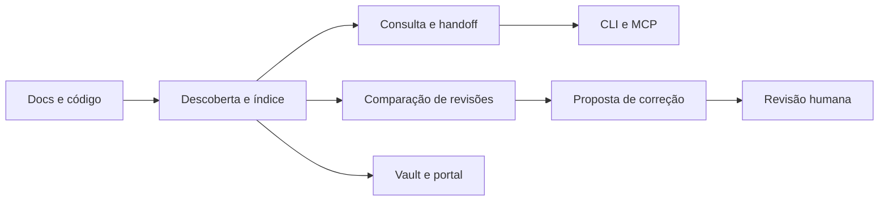

# 00 Hub - doc-bridge

> [!tldr] Em linguagem comum
> É o mapa que ajuda uma pessoa ou agente a encontrar onde mexer num projeto e como conferir a mudança. Também compara documentação com código e prepara correções para revisão; o núcleo funciona sem IA.

## Para que existe e quem usa

**Público**, MIT. Pacote `@agentskit/doc-bridge` 2.1.0, Node ≥22, TypeScript, pnpm, Zod, parsers Markdown/TypeScript e Graphology. O workspace declara somente a raiz; os módulos abaixo são separações do código, não publicações npm independentes. `apps/docs` é um app sem manifesto próprio.

| Peça | Para que serve |
|---|---|
| [[doc-bridge-indexacao]] | Descobrir entidades, relações e responsáveis |
| [[doc-bridge-consulta-mcp]] | Entregar contexto e próximos passos pela CLI/MCP |
| [[doc-bridge-divergencia]] | Comparar revisões, auditar e preparar correções |
| [[doc-bridge-memoria-vault]] | Transformar memórias e edições de mapa em propostas |
| [[doc-bridge-inteligencia]] | Acrescentar RAG e chat opcionais |
| [[doc-bridge-docs]] | Portal humano estático com conteúdo para agentes |

## Fluxos principais

- [[Doc Bridge - Do repositório ao handoff]]
- [[Doc Bridge - Da divergência à correção revisável]]
- [[Doc Bridge - Da memória e do vault à proposta]]

## Como se liga ao ecossistema

| Vizinho | Relação observada |
|---|---|
| [[00 Hub - alexandria]] | Consome a API pública 2.0.0 para comparar checkouts; não copia o motor |
| [[00 Hub - agents-playbook]] | Usa a CLI de indexação e os gates, além da Action de advisory |
| [[00 Hub - agentskit]] | Peers opcionais para RAG, adapters, memória e terminal |
| [[00 Hub - agentskit-chat]] | O portal usa Chat como superfície opcional |
| [[00 Hub - agentskit-registry]] | Adaptador de agentes do Registry para enriquecimento revisável |
| [[00 Hub - harness]] | Dependência direta `@agentskit/harness`; binário `ak-verify` e integração de verificação |
| [[00 Hub - ecosystem-distribution-ops]] | Distribuição em registries fora do motor |

## Dados, deploy e CI

O uso principal roda na máquina ou CI do consumidor. Configuração e docs originam `.doc-bridge/index.json`, capabilities, snapshots e artefatos de propostas. Não há banco hospedado obrigatório. Contratos novos de armazenamento particionado e perfil `service` não provam que exista um serviço hospedado neste repo.

O portal gera `apps/docs/out`: Wrangler configura **Cloudflare Workers static assets**, e `pages.yml` também publica em **GitHub Pages**. Há configuração Vercel remanescente; isso não prova tráfego atual. npm é o canal do pacote; MCPB e plugins são embalagens do mesmo motor.

CI em `ubuntu-latest`: `ci.yml` faz tipos, testes, cobertura, build, empacotamento, gates documentais, determinismo do índice, Lighthouse e Playwright. `release.yml` verifica tag estável, publica npm com provenance e prepara release GitHub; `changesets.yml` é outro caminho de versionamento/publicação. `pages.yml` publica o portal; `ecosystem-sync.yml` atualiza snapshot; CodeQL, Scorecard e dependency-review cobrem segurança; `doc-bridge-advisory.yml` relata impacto documental.

> [!warning] Limite da evidência
> O README distingue estimativa histórica de redução de contexto, tokens de provedor e precisão de casos controlados. Nenhuma dessas métricas garante correção semântica geral; auditoria de prosa natural continua não analisada sem revisão humana/agente configurada.

> [!info]- Detalhe técnico
> - `doc-bridge/package.json:2`.
> - `doc-bridge/pnpm-workspace.yaml:1`.
> - `doc-bridge/src/index.ts:249`.
> - `doc-bridge/src/index.ts:1036`.
> - `doc-bridge/wrangler.toml:1`.
> - `doc-bridge/apps/docs/next.config.mjs:10`.
> - `doc-bridge/.github/workflows/ci.yml:17`.
> - `doc-bridge/.github/workflows/pages.yml:18`.
> - `doc-bridge/.github/workflows/release.yml:24`.
> - `doc-bridge/.github/workflows/changesets.yml:15`.
> - `doc-bridge/README.md:97`.
