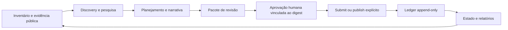

# 00 Hub - ecosystem-distribution-ops

> [!tldr] Em linguagem comum
> É a mesa de operação que escolhe onde apresentar os produtos AgentsKit, prepara o material e registra o que aconteceu. Agentes podem pesquisar e sugerir; publicar ou enviar exige aprovação humana do conteúdo exato.

## Para que existe e quem usa

Repo **privado**, separado dos produtos públicos e sem obrigação para contribuidores externos. Projeto único Node ≥22, ESM `.mjs`, sem dependências npm declaradas nem workspaces. Binários e módulos são ferramentas de operação; artefatos de campanhas com package.json não constituem workspaces do controle central.

| Módulo | Responsabilidade |
|---|---|
| [[distribution-operacao]] | Qualificação, ondas, pacotes e decisão de envio |
| [[distribution-ledger]] | Histórico encadeado, projeção de estado e recibos |
| [[distribution-inteligencia]] | Discovery, planner, narrativa, aprendizagem e revisão consultiva |
| [[distribution-expansao]] | Pesquisa isolada, reconciliação e promoção consultiva |

## Fluxos

- [[Distribuição - Da oportunidade ao envio autorizado]]
- [[Distribuição - Da evidência ao pacote de revisão]]
- [[Distribuição - Do evento ao estado operacional]]
- [[Distribuição - Da pesquisa à expansão revisável]]

## Relações e dados

| Vizinho | Como se liga |
|---|---|
| [[00 Hub - doc-bridge]] | Distribui pacote/skills/MCP; workflow manual publica manifesto no MCP Registry |
| [[00 Hub - agents-playbook]] | Campanhas e artefatos para divulgação dos gates npm |
| [[00 Hub - agentskit]], [[00 Hub - agentskit-chat]], [[00 Hub - agentskit-registry]], [[00 Hub - code-review]], [[00 Hub - harness]] | Produtos do inventário/campanhas de distribuição; não são dependências npm deste projeto |
| [[00 Hub - agentskit-os]] | Implementação, evidências e identificadores privados ficam fora das campanhas públicas por contrato |

Inventário/configuração ficam em `config/` e `data/opportunities.json`; `ledger/events.ndjson` é a origem de aprovações, submissões, distribuição manual e refresh. `data/state.json` e relatórios são projeções. `packets/`, `campaigns/` e artefatos guardam preparação; o conteúdo não foi reproduzido com dados pessoais no vault. Roadmap pré-seed é gerado de inventário estruturado e não envia inscrição.

## Execução, infraestrutura e CI

Scripts rodam no ambiente do operador; alguns conectores usam `gh`/HTTP e os publishers acionam GitHub, Bluesky e Mastodon conforme oportunidade suportada. Não há serviço web permanente ou banco cloud declarado na raiz. Ferramentas de publicação só devem operar sob seus próprios gates.

O único workflow versionado é `publish-docbridge-mcp.yml`: dispatch manual, runner **blacksmith-2vcpu-ubuntu-2404**, publisher MCP fixado e verificado por SHA-256, login GitHub OIDC e confirmação da publicação 2.0.0. O checkout não define CI geral automática de testes. Checks locais documentados: `npm run check`, `npm run check:coverage`, `npm run ledger:verify`; não foram executados nesta análise estática.

> [!warning] Limite de autoridade
> `approvalReady` e artefato de revisão não são aprovação. O caminho de envio confere conteúdo, validação, regras do destino, aprovação e capacidade; dry-run é padrão. O limite de contribuições externas é cinco, separado da faixa de canais próprios.

> [!info]- Detalhe técnico
> - `ecosystem-distribution-ops/README.md:1`.
> - `ecosystem-distribution-ops/package.json:1`.
> - `ecosystem-distribution-ops/src/core.mjs:147`.
> - `ecosystem-distribution-ops/src/core.mjs:176`.
> - `ecosystem-distribution-ops/src/ledger.mjs:26`.
> - `ecosystem-distribution-ops/src/operator-review-loop.mjs:237`.
> - `ecosystem-distribution-ops/.github/workflows/publish-docbridge-mcp.yml:13`.
