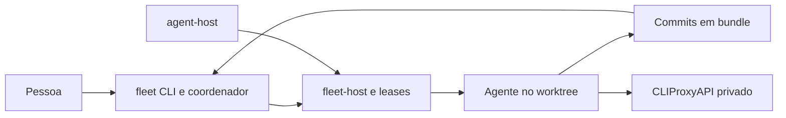

# 00 Hub - fleet

> [!tldr] Em linguagem comum
> Máquinas privadas que executam tarefas de agentes para a equipe, preservando a revisão e a entrega no computador de quem pediu.

## Para que existe e quem usa

[[00 Hub - skills]] entrega [[fleet-skill]]; [[00 Hub - agentskit]] fornece [[agentskit-core]] e portabilidade. [[00 Hub - harness]] também coordena agentes, mas os conectores lidos não provam integração direta com fleet.

| Característica | O que está declarado |
|---|---|
| Visibilidade | Privado |
| Stack | TypeScript/Node 22, Python de referência, Orca headless, SSH, Tailscale e CLIProxyAPI. |
| Consumidores | Equipe AgentsKit e integrações da tabela abaixo |

## Partes principais

| Pacote / aplicação / módulo | Papel |
|---|---|
| [[agent-host]] | Prepara e mantém as máquinas da equipe, separando a máquina que guarda os logins daquela que executa código. |
| [[fleet-cli]] | É o balcão de pedidos da frota: recebe uma tarefa, escolhe uma máquina disponível e traz os commits de volta para revisão. |
| [[fleet-host]] | É o porteiro de cada máquina: controla as vagas e só inicia o agente quando há capacidade e a política permite. |
| [[quota-shadow]] | Observa quanto resta das contas de IA para ajudar a evitar parar um trabalho no meio. |

## Fluxos principais

| Fluxo | Resultado |
|---|---|
| [[Fleet - Do pedido ao commit coletado]] | Uma pessoa entrega uma tarefa à frota; uma máquina livre faz o trabalho e devolve commits para revisão local. |
| [[Fleet - Preparar host e acesso]] | O operador prepara uma máquina para guardar logins ou executar agentes, sem misturar os dois papéis. |

## Deploy e dados

Operação rootless em hosts Linux; coordenador no computador do operador, supervisionável como serviço de usuário. Separação proxy/agents reduz a exposição dos logins. Não é provisionador de nuvem.

## CI e verificações declaradas

Sem .github/workflows no clone. package.json declara pnpm check (tipos, portabilidade, testes, bundles e checksums); análise estática não executou esses checks.

## Limites e divergências

README contradiz a si mesmo: diz Python atual, depois TypeScript em hosts reais, mas mantém tabelas “não executado em host real”. O registro de aceite descreve migração e pendências de segunda pessoa. Trate isso como divergência documental, não como estado de produção verificado.

Nenhuma instalação, build, teste, chamada de serviço ou alteração de infraestrutura foi executada. O que depende de ambiente real fica no material para consolidação desta pasta.

> [!info]- Detalhe técnico
> - `fleet/README.md:5`.
> - `fleet/package.json:1`.
> - `fleet/docs/validation/real-host-acceptance-2026-10-15.md:1`.
