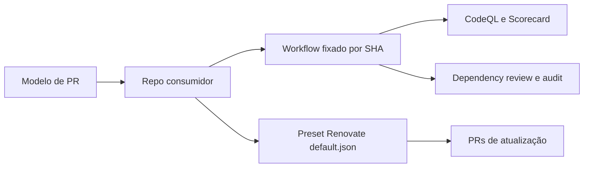

# 00 Hub - .github

> [!tldr] Em linguagem comum
> É a pasta de regras compartilhadas da organização no GitHub: oferece verificações de segurança reutilizáveis, um modelo de PR e a política de atualização de dependências.

## Para que existe e quem usa

Repo **público**, sem package.json, apps ou workspaces. Stack: GitHub Actions/YAML, Renovate/JSON e um script Node auxiliar. Os chamadores mantêm seus próprios gatilhos, builds, releases e checks específicos.

| Módulo | O que oferece |
|---|---|
| [[github-org-workflows]] | Quatro workflows reutilizáveis e helper de audit |
| [[github-org-governanca]] | Preset Renovate, override local e modelo de PR |

## Fluxos

- [[GitHub Org - Da chamada ao resultado de segurança]]
- [[GitHub Org - Da dependência ao PR de atualização]]

## Como se liga ao ecossistema

| Consumidor | Evidência/limite |
|---|---|
| [[00 Hub - agents-playbook]] | Chamadas CodeQL/Scorecard/dependency-review/audit fixadas no SHA e921ea2 |
| [[00 Hub - agentskit]], [[00 Hub - agentskit-chat]], [[00 Hub - code-review]] | Inventário de integração descrito no README; confirmar configuração atual nos hubs desses repos |
| [[00 Hub - doc-bridge]] | Inventário histórico do README; checkout atual tem workflows de segurança próprios, não chamadas centralizadas |

## Dados, infraestrutura e CI

Roda no GitHub Actions em **ubuntu-latest**. CodeQL/Scorecard produzem SARIF no GitHub Security; Scorecard também publica artefato e resultados upstream. Audit usa npm/pnpm e, opcionalmente, Bulk Advisory API do npm. Não há banco, site ou deploy de produto.

`self-test.yml` roda actionlint 1.7.12, CodeQL para linguagem `actions`, Scorecard nas condições do workflow e uma chamada audit com lista de diretórios vazia, portanto **sem audit efetivo**. Dependency review não é chamado no self-test; README explica a dependência do grafo GitHub desabilitado aqui. Esses limites impedem tratar o self-test como prova end-to-end de todos os quatro serviços.

## Arquivos comunitários presentes e ausentes

O checkout tem `.github/PULL_REQUEST_TEMPLATE.md` e README. Não há CONTRIBUTING, CODE_OF_CONDUCT, SECURITY, issue templates, perfil `profile/README.md` ou outros community health files além desse modelo. O local sob `.github/` é observado; herança efetiva por outro repo depende das regras GitHub e de seus próprios arquivos, não foi testada.

O README exemplifica chamadas ao SHA a92994b; o HEAD é e921ea2 e o Playbook já fixa este último. Exemplo documentado e adoção atual não devem ser confundidos.

> [!info]- Detalhe técnico
> - `.github/README.md:1`.
> - `.github/.github/PULL_REQUEST_TEMPLATE.md:1`.
> - `.github/.github/workflows/self-test.yml:10`.
> - `.github/.github/workflows/audit.yml:35`.
> - `.github/.github/workflows/codeql.yml:27`.
> - `.github/default.json:1`.
> - `.github/renovate.json:6`.
