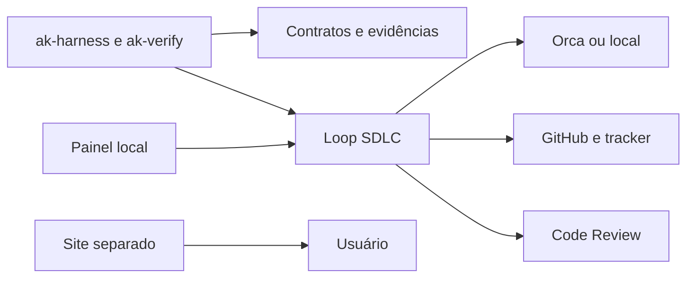

# 00 Hub - harness

> [!tldr] Em linguagem comum
> Organiza a esteira de desenvolvimento, da ideia à entrega, exigindo contrato, provas e decisões humanas onde a política pede.

## Para que existe e quem usa

Usa [[00 Hub - code-review]] para revisão, [[00 Hub - doc-bridge]] para contexto, [[00 Hub - agentskit]] para contratos/utilitários; tracker Linear ou GitHub. [[00 Hub - skills]] lê estado para relatórios.

| Característica | O que está declarado |
|---|---|
| Visibilidade | Público; apps de docs são pacotes privados |
| Stack | TypeScript/Node 22, Commander, Zod/YAML, Ink, React/Vite; docs Next.js/Fumadocs em workspace separado. |
| Consumidores | Equipe AgentsKit e integrações da tabela abaixo |

## Partes principais

| Pacote / aplicação / módulo | Papel |
|---|---|
| [[harness-docs]] | É o site público que ensina a instalar, configurar e operar o Harness. |
| [[harness-kernel]] | É o fiscal do contrato: registra o que foi pedido, as provas e a decisão humana antes de considerar o trabalho encerrado. |
| [[harness-loop]] | É a esteira que transforma uma issue em trabalho de agente, revisão e entrega, guardando provas em cada passagem. |
| [[harness-ui]] | É o painel local para escolher uma issue, acompanhar trabalho e responder às decisões que pedem uma pessoa. |

## Fluxos principais

| Fluxo | Resultado |
|---|---|
| [[Harness - Da issue ao merge]] | A issue vira um contrato verificável; um agente implementa em espaço separado e a entrega passa por provas e revisão. |
| [[Harness - Planejar e liberar com decisão humana]] | Objetivo vira plano e issues, e uma versão só é liberada depois da aprovação vinculada ao código. |

## Deploy e dados

CLI roda no ambiente da equipe; runner Orca ou local (git/tmux/crontab). UI operacional escuta loopback; site de docs gera export para Cloudflare Workers assets. Não há serviço SaaS obrigatório declarado.

## CI e verificações declaradas

release-harness.yml reúne verificação, docs e matriz loop Ubuntu/macOS/Windows; publicação npm por Trusted Publishing depende dos jobs anteriores. Scripts incluem tipos, testes, contratos, exemplos e checks de documentação.

## Limites e divergências

ak-harness e ak-verify são dois binários da mesma CLI. O arquivo loop.config.yaml pertence ao loop; não é o esquema .github/ai-loop.yaml de outro executor. UI operacional e site público têm funções diferentes.

Nenhuma instalação, build, teste, chamada de serviço ou alteração de infraestrutura foi executada. O que depende de ambiente real fica no material para consolidação desta pasta.

> [!info]- Detalhe técnico
> - `harness/README.md:9`.
> - `harness/package.json:1`.
> - `harness/src/loop/runner-connector.ts:19`.
> - `harness/.github/workflows/release-harness.yml:85`.
> - `harness/wrangler.toml:1`.
