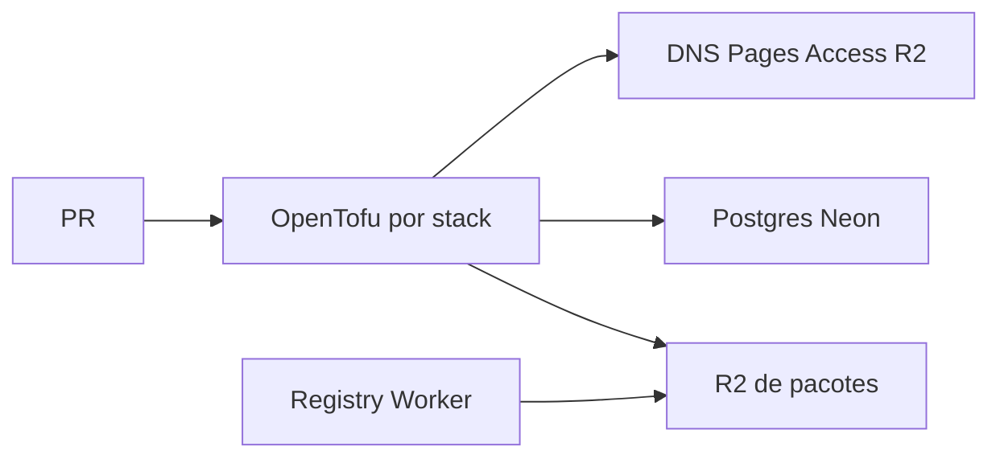

# 00 Hub - infra

> [!tldr] Em linguagem comum
> Mantém os recursos de nuvem compartilhados e dos produtos: endereços, proteção de acesso, arquivos e banco.

## Para que existe e quem usa

Atende [[00 Hub - law-os]], [[00 Hub - marketing-os]] e [[00 Hub - agentskit-os]]. [[agentskit-npm-registry]] distribui pacotes privados da plataforma, e é diferente do catálogo [[00 Hub - agentskit-registry]].

| Característica | O que está declarado |
|---|---|
| Visibilidade | Privado — GitHub API, 2026-10-16, confirmação do coordenador |
| Stack | OpenTofu/HCL, Cloudflare DNS/Pages/Access/R2, Neon e Worker TypeScript. |
| Consumidores | Equipe AgentsKit e integrações da tabela abaixo |

## Partes principais

| Pacote / aplicação / módulo | Papel |
|---|---|
| [[agentskit-npm-registry]] | É a prateleira privada de pacotes da plataforma: os builds podem baixar versões que não mudam depois de publicadas. |
| [[infra-agentskit]] | Mantém os endereços e recursos compartilhados do ecossistema que não pertencem às stacks de produto. |
| [[infra-law-os]] | Reserva os endereços, bancos e depósitos de documentos do produto jurídico. |
| [[infra-marketing-os]] | Define a porta de acesso protegido do Marketing OS. |
| [[infra-registry]] | Cria o depósito que impede apagar ou trocar um pacote já publicado. |

## Fluxos principais

| Fluxo | Resultado |
|---|---|
| [[Infra - Da alteração ao recurso]] | Uma mudança revisada mostra primeiro o que vai mudar na infraestrutura; o merge em main autoriza aplicar. |
| [[Infra - Publicar e instalar pacote privado]] | A plataforma publica uma versão uma única vez e o build jurídico baixa exatamente aqueles bytes. |

## Deploy e dados

Conta, zonas e bucket de estado pertencem à infra da NoxCodeSolutions; stacks AgentsKit usam chaves agentskit/<stack>.tfstate e criptografia cliente. O Worker npm é implantado por Wrangler. Worker de produto não é gerido por OpenTofu.

## CI e verificações declaradas

tofu.yml usa ubuntu-latest, descobre stacks e limita matriz a uma por vez; fmt/init, plan no PR e apply em main. Mudanças em registry/ não estão no filtro de paths dessa automação.

## Limites e divergências

O código declara homologação Workers com branch/bucket próprios e preserva Railway como rollback nos comentários; não prova qual backend recebe tráfego hoje. Segredos, roles e bancos com senha ficam no bootstrap do produto/1Password, fora de OpenTofu.

Nenhuma instalação, build, teste, chamada de serviço ou alteração de infraestrutura foi executada. O que depende de ambiente real fica no material para consolidação desta pasta.

> [!info]- Detalhe técnico
> - `infra/README.md:1`.
> - `infra/.github/workflows/tofu.yml:1`.
> - `infra/stacks/law-os/neon.tf:43`.

> [!info]- Metadado de visibilidade
> GitHub API, 2026-10-16: o coordenador confirmou `infra PRIVATE` por `gh repo list AgentsKit-io`. Nenhum recurso de infraestrutura foi consultado ou alterado nesta confirmação.
