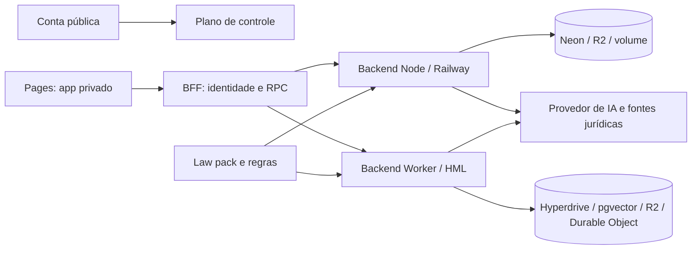

# 00 Hub - law-os

> [!tldr] Em linguagem comum
> É o produto privado da AgentsKit para escritórios de advocacia: reúne casos, documentos e IA assistida, mas mantém o advogado responsável por aprovar o trabalho jurídico.

← [[00 Hub - law-os]]

## Para que existe e quem usa

| Público / relação | Uso |
|---|---|
| Advogados e escritórios | Trabalhar casos, conversar sobre documentos, produzir pareceres e revisar propostas |
| Equipe do produto e operação | Manter telas, conteúdo jurídico e composição/implantação independente |
| [[00 Hub - agentskit-os]] | Fornece plataforma privada publicada: execução, segurança, conhecimento, governança e shell |
| [[00 Hub - agentskit]] e [[00 Hub - agentskit-chat]] | Primitivas OSS e chat consumidos pelos manifests |
| [[00 Hub - ak-cloud]] | Fronteira do plano de controle: conta, contratação, provisão e execução paga |
| [[00 Hub - infra]] | Registry privado do tier documentado no AGENTS.md |

**Visibilidade:** privado/proprietário; o app de conta é uma superfície web pública, não um repositório OSS. Stack: React 19, TypeScript, Vite, Tailwind; BFF Cloudflare Worker; backend Node 22 ou Workers; pnpm 10.33.0. Tier privado em **rc.20**, consumido pelo registry npm.agentskit.io; OSS @agentskit/* vem do npm. O produto mantém seu próprio backend e conteúdo, sem copiar fontes da plataforma.

## Apps, workspaces e módulos locais

Quatro membros do workspace raiz: apps/law-os, apps/law-os-account e os dois tests/*. Backend e ferramentas do backend Worker são instalações isoladas com manifest próprio. Os demais itens são módulos separáveis, não pacotes npm publicados. desktop-* e pack-loader pertencem à plataforma e só recebem links.

| Nota | Papel |
|---|---|
| [[addressing]] | Módulo ou ferramenta do produto |
| [[bert-local]] | Módulo ou ferramenta do produto |
| [[bff-worker]] | Módulo ou ferramenta do produto |
| [[case-document]] | Módulo ou ferramenta do produto |
| [[caselaw]] | Módulo ou ferramenta do produto |
| [[contract-facts]] | Módulo ou ferramenta do produto |
| [[criminal-extinction]] | Módulo ou ferramenta do produto |
| [[criminal-prescription]] | Módulo ou ferramenta do produto |
| [[front-approvals]] | Módulo ou ferramenta do produto |
| [[front-conversation]] | Módulo ou ferramenta do produto |
| [[front-deliverables]] | Módulo ou ferramenta do produto |
| [[front-knowledge]] | Módulo ou ferramenta do produto |
| [[front-learning]] | Módulo ou ferramenta do produto |
| [[front-matters]] | Módulo ou ferramenta do produto |
| [[front-run-context]] | Módulo ou ferramenta do produto |
| [[law-os-account]] | Aplicação pública de conta |
| [[law-os]] | Host privado do advogado |
| [[law-os-backend]] | Módulo ou ferramenta do produto |
| [[law-os-backend-worker-tools]] | Módulo ou ferramenta do produto |
| [[law-pack]] | Conteúdo jurídico |
| [[legal-rules]] | Módulo ou ferramenta do produto |
| [[legal-trees]] | Módulo ou ferramenta do produto |
| [[legislation]] | Módulo ou ferramenta do produto |
| [[opinion-validate]] | Módulo ou ferramenta do produto |
| [[tests-e2e-law-os-layout]] | Testes de navegador |
| [[tests-e2e-playwright]] | Testes de navegador |

## Fluxos principais

| Fluxo | Resultado |
|---|---|
| [[Revisão de contratos - law-os]] | Parecer conferido, aprovação humana e PDF; inclui ramo revisionOf |
| [[Pesquisa de jurisprudência - law-os]] | Citações encontradas na fonte e filtradas por autoridade do link |
| [[Dossiê contencioso - law-os]] | Fatos com origem e proposta editável, com gates de lacunas e aprovação |
| [[Cadastro do escritório - law-os]] | Contratação na conta pública e acompanhamento da provisão externa |

## Deploy e infraestrutura

Pages serve os bundles do produto e conta; o BFF é Worker. O caminho Node usa Docker, Railway e volume /data, com Neon e R2 no hospedado. Existe também entrada backend Workers com Durable Object, Hyperdrive/pgvector e R2, usada pelo workflow HML. GHCR recebe a imagem privada; o registry do tier é npm.agentskit.io. O segredo npmrc entra na build Docker por mount BuildKit, nunca ARG/ENV. Segredos de runtime ficam no host/Worker; nenhuma chave pertence a VITE_*.

[[Onde ficam os dados - law-os]] separa as duas distribuições de estado. Configuração versionada não prova qual ambiente está ativo em produção.

## CI: o que está configurado

| Workflow | Runner / finalidade |
|---|---|
| ci.yml | self-hosted, akos-local: extração, scripts de provisão, instalação e checks do produto |
| smoke.yml | self-hosted, akos-local: tier/BOM, bundle sem credenciais, auth, Playwright e imagem backend |
| publish-backend-image.yml | self-hosted, akos-local: BuildKit → GHCR privado |
| deploy-law-os-hml.yml | self-hosted, akos-local, macOS, ARM64: backend Worker, BFF e Pages HML |
| deploy-law-os.yml e deploy-law-os-early-access.yml | ubuntu-latest: bundles Pages de demo/early access |
| configure-demo-access.yml | ubuntu-latest: aplicações e políticas de Access |
| notify-deploys.yml | ubuntu-latest: notificação de deploy configurada; nada enviado nesta análise |
| local-dev-native.yml | ubuntu-latest, macos-latest, windows-latest: launcher local |

## Docs antigas versus código atual

O README ainda fala em oito features e pins rc.13. compose.mjs tem **13 entradas** e os manifests/BOM estão em **rc.20**. O import em b5d3c87 descreve 15 nós de revisão; agora são **18**, pelo ramo revisionOf. O README enfatiza Railway, enquanto o workflow HML publica o backend Worker. Nenhuma dessas constatações comprova migração de todas as instalações.

> [!bug] Existe, mas ninguém usa
> [[criminal-extinction]] e [[criminal-prescription]] não têm chamadores de produção encontrados. NER de [[bert-local]] não está ligado a fluxo. Árvores e endereçamento de [[opinion-validate]] exigem dados que o grafo de revisão não fornece. Detalhes e dúvidas em [[Dúvidas abertas|Dúvidas e capacidades consolidadas]].

> [!info]- Detalhe técnico
> - `AGENTS.md:1` (relativo ao law-os).
> - `pnpm-workspace.yaml:1` (relativo ao law-os).
> - `compatibility-bom.json:1` (relativo ao law-os).
> - `apps/law-os/backend/compose.mjs:139` (relativo ao law-os).
> - `.github/workflows/deploy-law-os-hml.yml:96` (relativo ao law-os).
> - `.github/workflows/ci.yml:1` (relativo ao law-os).
> - `.github/workflows/smoke.yml:1` (relativo ao law-os).
> - `.github/workflows/publish-backend-image.yml:1`: configuração do workflow descrito na tabela.
> - `.github/workflows/deploy-law-os.yml:1`: configuração do workflow descrito na tabela.
> - `.github/workflows/deploy-law-os-early-access.yml:1`: configuração do workflow descrito na tabela.
> - `.github/workflows/configure-demo-access.yml:1`: configuração do workflow descrito na tabela.
> - `.github/workflows/notify-deploys.yml:1`: configuração do workflow descrito na tabela.
> - `.github/workflows/local-dev-native.yml:1`: configuração do workflow descrito na tabela.
