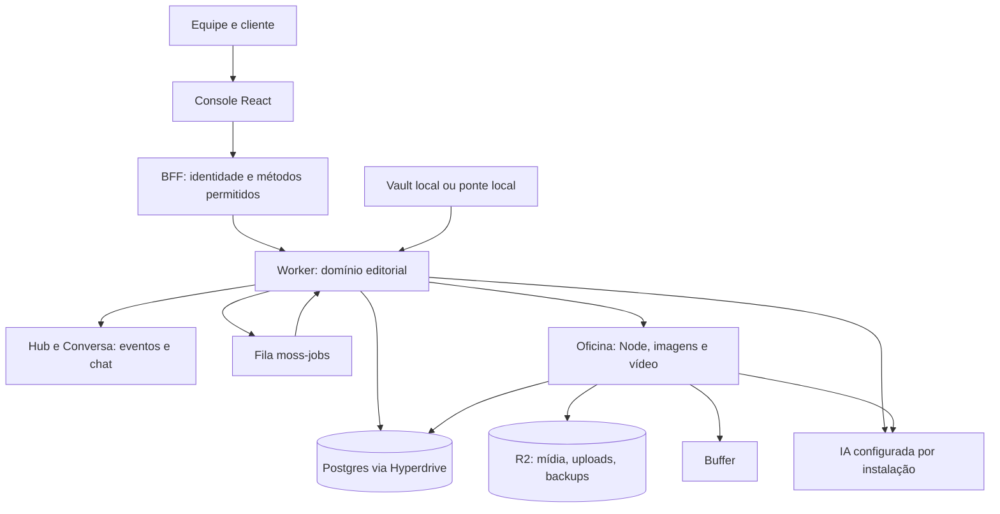

# marketing-os — MOSS

> [!tldr] Em linguagem comum
> É a oficina editorial de uma equipe ou agência: reúne o jeito de falar de cada marca, propõe o calendário, ajuda a escrever e desenhar conteúdos e exige revisão antes do envio às redes pelo Buffer. Uma instalação atende um cliente e pode conter várias marcas, com pessoas e permissões diferentes.

## Para que existe e quem usa

| Quem | Como usa |
|---|---|
| Estrategista | Define marca, canais, estratégia e aceita o plano editorial |
| Redator | Escreve, regenera e edita peças com fontes e verificações |
| Aprovador e cliente | Conferem conteúdo; o cliente pode decidir por link assinado |
| Agência | Vê pendências de várias marcas na mesma instalação |
| [[00 Hub - agentskit-os]] | Fornece pacotes privados de interface; recebe candidatos à extração hoje em [[marketing-os-vendor]] |
| [[00 Hub - agentskit]] | Origem da primitiva de Markdown vendorizada |
| [[00 Hub - law-os]] | Referência de separação produto/plataforma e instalação; não é dependência de execução |

**Visibilidade:** repositório privado (metadado GitHub consultado em 2026-10-16); os dois pacotes do produto também têm `private: true`. Não é um serviço genérico de publicação nem um pack YAML do Law OS: o domínio editorial tem servidor, contratos e agente próprios.

## As peças

Stack: Vite 6, React 19, TypeScript, Tailwind 3, Zod 4; Node 22 e módulos JavaScript no backend; Hono no Worker; PostgreSQL 16 no ambiente local. A Oficina inclui HyperFrames, Chromium, FFmpeg e bibliotecas de desenho/PDF.

| Nota | Unidade e responsabilidade |
|---|---|
| [[marketing-os]] | Único workspace raiz (`apps/*`): console e contrato compartilhado |
| [[marketing-os-backend]] | Pacote Node privado, instalado separadamente; domínio e persistência |
| [[marketing-os-agent]] | Módulo interno de geração, chat, evidência e custo |
| [[marketing-os-bff]] | Módulo interno de autenticação, RPC e eventos |
| [[marketing-os-cloud]] | Worker, Durable Objects, filas e Oficina; não é pacote npm separado |
| [[marketing-os-vendor]] | Cópias temporárias de código das camadas inferiores |
| [[moss-e2e-flows]] | Pacote independente de Playwright, fora do workspace pnpm |

## Os caminhos principais

| Fluxo | Entrada → resultado |
|---|---|
| [[MOSS - Sincronizar marca e planejar]] | Notas e estratégia → plano aceito e peças no calendário |
| [[MOSS - Redigir e aprovar]] | Peça planejada → versão revisada, sem lacunas abertas, aprovada |
| [[MOSS - Produzir imagens e vídeos]] | Perfil e versão → slides, PDF ou MP4 vinculado à aprovação |
| [[MOSS - Enviar e acompanhar no Buffer]] | Versão aprovada → recibo, estado remoto e métricas |

## Como se liga ao ecossistema

| Origem | Ligação verificada |
|---|---|
| [[os-ui]] | Componentes, tokens, temas e catálogos de idioma usados pelo console |
| [[desktop-agent-workspace]] | Contexto de marca do workspace |
| [[desktop-agent-workspace-copilot]] e [[os-core]] | Interface da conversa e tipos de mensagem |
| [[desktop-sidecar-bridge]] | Transporte reutilizado pelos hooks; inicializado com `/api`, sem credencial do backend no navegador |
| [[os-runtime-agentskit]] | Origem declarada do adaptador CLI copiado; não é um runtime headless filho |
| [[os-contracts]] | Destino proposto para contratos editoriais; hoje são locais e gerados para Node |

Não foi encontrado consumidor externo deste produto nos arquivos lidos. Uma origem ou destino pretendido de extração não equivale a dependência npm já ativa.

## Dados, instalação e deploy

| Lugar | O que fica lá |
|---|---|
| Postgres, schema `moss` | Marcas, membros, snapshots, planos, peças, versões, aprovações, recibos, custos, auditoria e conexões Buffer criptografadas |
| Schema `mos` no Node legado | Compatibilidade pré-M1, sem montagem no Worker hospedado |
| R2 `MEDIA`, `UPLOADS`, `BACKUPS` | Mídia entregue por links assinados, arquivos enviados e dumps diários |
| Durable Objects `HUB`, `CONVERSA`, `OFICINA` | Coordenação de eventos/chat e ciclo do container |
| Arquivo de instalação fora do repo | Configuração; `MOS_INSTALL_CONFIG_B64`/`MOS_INSTALL_CONFIG_FILE`, sem publicar valores |
| Vault da marca | Fontes de leitura; escrita restrita de tema da newsletter quando habilitada |

O alvo hospedado definido é **um Cloudflare Worker por instalação**, com assets do console, API e backend em processo; trabalho pesado vai à Oficina. Hyperdrive conecta ao Postgres (Neon é o serviço citado na documentação). Não há caminho atual de deploy em Railway ou Pages. O arquivo Wrangler ainda traz identificadores locais: ele prova a topologia, não uma instalação em produção. O cron às 06:17 UTC pede `pg_dump` à Oficina, grava em R2 e remove dumps anteriores à janela de 14 dias.

No nativo, `moss-local` organiza Docker/Postgres, backend Node, BFF e Vite. A pilha Cloudflare também pode ser simulada localmente com Wrangler e Docker. CLI local, ponte HTTP local, templates offline, OpenRouter e Anthropic são caminhos de IA selecionáveis; não se deve presumir qual está ativo numa instalação.

## CI que está configurada

| Workflow | Quando / runner | O que faz |
|---|---|---|
| `ci.yml` | PR e push em main / `ubuntu-latest` | Extração, contrato gerado, tipos, testes, build, varredura do bundle, backend com Postgres e testes cloud; outro job só coleta specs E2E |
| `smoke-cloud.yml` | Manual / `ubuntu-latest` | Seis fluxos Playwright na pilha local Cloudflare, IA offline, Buffer simulado |
| `local-dev-native.yml` | Manual e PR por caminhos / Ubuntu e macOS | Testes do launcher e CLI falso; não autentica CLIs reais |
| `refresh-lockfiles.yml` | Manual / `ubuntu-latest` | Atualiza lockfiles e commita na branch indicada |

Os workflows leem o tier privado de GitHub Packages. Esta análise não disparou CI nem comprova que os workflows passaram.

> [!warning] Docs e código divergem
> O README ainda afirma que o produto só cria rascunhos no Buffer e nunca agenda. Há `dispatch.schedule`, `dispatch.unschedule` e envio com `mode: scheduled`, protegidos por confirmação e habilitação da instalação. O cabeçalho de `dispatch.mjs` também ficou antigo. O README diz que não escreve no workspace, mas existe a exceção explícita do tema da newsletter. O resumo “M0 e M1 em progresso” não descreve sozinho a amplitude atual de imagens, vídeo, OAuth, estratégia e métricas.

> [!info]- Detalhe técnico
> - Workspaces: `pnpm-workspace.yaml:1`; pacotes: `apps/marketing-os/package.json:2`, `apps/marketing-os/backend/package.json:2`, `e2e/package.json:2`.
> - Composição Node: `apps/marketing-os/backend/compose.mjs:14`; Worker: `apps/marketing-os/cloud/src/index.mjs:23`, `apps/marketing-os/cloud/src/runtime.mjs:50`.
> - Infra: `apps/marketing-os/cloud/wrangler.jsonc:9`; backup: `apps/marketing-os/cloud/src/backup.mjs:3`.
> - CI: `.github/workflows/ci.yml:18`, `.github/workflows/smoke-cloud.yml:17`, `.github/workflows/local-dev-native.yml:24`, `.github/workflows/refresh-lockfiles.yml:14`.
> - Agendamento: `apps/marketing-os/backend/src/moss/services/dispatch.mjs:301`, `:348`; escrita excepcional: `apps/marketing-os/backend/src/moss/services/newsletter-handoff.mjs:1`.

Dúvidas e material para consolidação estão em [[Dúvidas abertas]] e [[Capacidades não usadas]].
