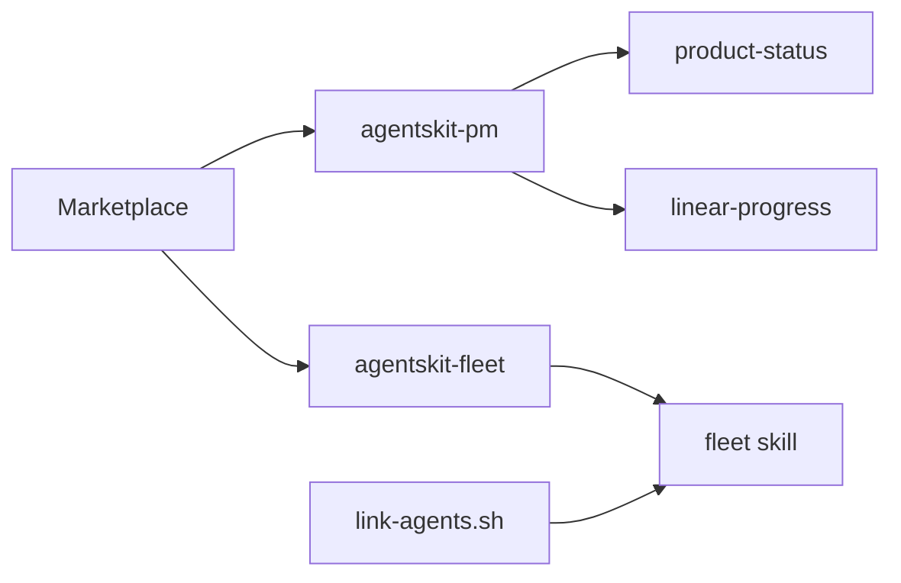

# 00 Hub - skills

> [!tldr] Em linguagem comum
> Distribui os roteiros internos que ensinam os agentes a acompanhar entregas e usar a frota do time.

## Para que existe e quem usa

[[agentskit-pm]] acompanha [[00 Hub - law-os]] e consulta [[00 Hub - harness]]; [[fleet-skill]] opera [[00 Hub - fleet]]. A distribuição é separada das skills públicas de [[00 Hub - agents-playbook]].

| Característica | O que está declarado |
|---|---|
| Visibilidade | Privado |
| Stack | Markdown de skills, marketplace Claude Code, Python de relatórios e shell de instalação de links. |
| Consumidores | Equipe AgentsKit e integrações da tabela abaixo |

## Partes principais

| Pacote / aplicação / módulo | Papel |
|---|---|
| [[agentskit-pm]] | É um conjunto de roteiros para responder ao time como um produto está e qual trabalho pode avançar. |
| [[fleet-skill]] | Ensina os agentes a mandar implementação à frota e trazer o resultado para revisão no computador da pessoa. |
| [[linear-progress]] | Mostra os marcos, bloqueios e pessoas de um projeto para o time decidir o que puxar agora. |
| [[product-status]] | Traduz tickets e entregas em capacidades que alguém de produto entende, mostrando o que já pode ir para QA. |

| [[agentskit-fleet]] | É a embalagem de instalação da skill que encaminha implementação para as máquinas da equipe. |

## Fluxos principais

| Fluxo | Resultado |
|---|---|
| [[Skills - Produzir status com evidências]] | O agente junta as fontes e escreve um relatório em português, preservando as lacunas em vez de adivinhar prontidão. |

## Deploy e dados

Repo privado; instalação por marketplace git. Não possui backend hospedado nem pacote npm. Outros agentes recebem a fleet skill por links locais.

## CI e verificações declaradas

Sem .github/workflows no clone; não foi identificado pipeline CI versionado. A leitura de PRs dos produtos não é CI deste repo.

## Limites e divergências

product-status usa provas heurísticas de PR (seção Validation) e estado local harness; isso não executa aceites reais. A prontidão depende da qualidade das fontes coletadas.

Nenhuma instalação, build, teste, chamada de serviço ou alteração de infraestrutura foi executada. O que depende de ambiente real fica no material para consolidação desta pasta.

> [!info]- Detalhe técnico
> - `skills/README.md:1`.
> - `skills/.claude-plugin/marketplace.json:1`.
> - `skills/plugins/agentskit-pm/skills/product-status/scripts/collect_repo.py:38`.
