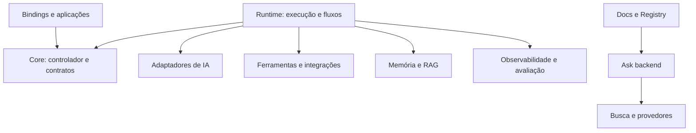

# agentskit

> [!tldr] Em linguagem comum
> É a caixa de peças pública do ecossistema: permite montar agentes de IA, trocar provedores, usar ferramentas e memória e apresentar conversas em diferentes interfaces. Também hospeda os sites de documentação e Registry e o serviço Ask compartilhado.

## Para quem existe

O framework é instalado pelas equipes que desenvolvem agentes e serve de base ao AgentsKit Chat. Os sites usam suas peças e o Ask atende propriedades do ecossistema. A relação com a plataforma privada pode ser acompanhada em [[00 Hub - agentskit-os]]; esta análise não mede adoção nem composição dos produtos privados.

**Visibilidade:** público/OSS (documentação pública e licença MIT; a configuração de visibilidade do GitHub não foi consultada). **Stack:** TypeScript, pnpm workspaces e Turbo; bibliotecas ESM/CJS, bindings de sete frameworks, apps Next.js/Fumadocs, exemplos Vite e servidor Hono.

## Nomes das notas

O coordenador confirmou o prefixo `agentskit-*` para todos os pacotes do framework, por compatibilidade com os links dos outros autores e para evitar nomes genéricos ambíguos. A tabela abaixo registra a correspondência entre nome da nota e nome npm.

## Peças do repositório

| Nota | Nome no manifesto / papel | Tipo |
|---|---|---|
| [[agentskit-adapters]] | `@agentskit/adapters` | pacote |
| [[agentskit-angular]] | `@agentskit/angular` | pacote |
| [[agentskit-cli]] | `@agentskit/cli` | pacote |
| [[agentskit-core]] | `@agentskit/core` | pacote |
| [[agentskit-cross-platform]] | `@agentskit/cross-platform` | pacote |
| [[agentskit-eval]] | `@agentskit/eval` | pacote |
| [[agentskit-eval-braintrust]] | `@agentskit/eval-braintrust` | pacote |
| [[agentskit-ink]] | `@agentskit/ink` | pacote |
| [[agentskit-integrations]] | `@agentskit/integrations` | pacote |
| [[agentskit-mcp]] | `@agentskit/mcp` | pacote |
| [[agentskit-memory]] | `@agentskit/memory` | pacote |
| [[agentskit-net]] | `@agentskit/net` | pacote |
| [[agentskit-observability]] | `@agentskit/observability` | pacote |
| [[agentskit-observability-langfuse]] | `@agentskit/observability-langfuse` | pacote |
| [[agentskit-rag]] | `@agentskit/rag` | pacote |
| [[agentskit-react]] | `@agentskit/react` | pacote |
| [[agentskit-react-native]] | `@agentskit/react-native` | pacote |
| [[agentskit-runtime]] | `@agentskit/runtime` | pacote |
| [[agentskit-sandbox]] | `@agentskit/sandbox` | pacote |
| [[agentskit-skills]] | `@agentskit/skills` | pacote |
| [[agentskit-solid]] | `@agentskit/solid` | pacote |
| [[agentskit-statechart]] | `@agentskit/statechart` | pacote |
| [[agentskit-svelte]] | `@agentskit/svelte` | pacote |
| [[agentskit-templates]] | `@agentskit/templates` | pacote |
| [[agentskit-tools]] | `@agentskit/tools` | pacote |
| [[agentskit-validation]] | `@agentskit/validation` | pacote |
| [[agentskit-vue]] | `@agentskit/vue` | pacote |
| [[agentskit-ask-backend]] | `@agentskit/ask-backend` | app |
| [[agentskit-docs-next]] | `@agentskit/docs-next` | app |
| [[agentskit-example-discord-bot]] | `@agentskit/example-discord-bot` | app |
| [[agentskit-example-dspy]] | `@agentskit/example-dspy` | app |
| [[agentskit-example-edge]] | `@agentskit/example-edge` | app |
| [[agentskit-example-embedded]] | `@agentskit/example-embedded` | app |
| [[agentskit-example-flow]] | `@agentskit/example-flow` | app |
| [[agentskit-example-ink]] | `@agentskit/example-ink` | app |
| [[agentskit-example-multi-agent]] | `@agentskit/example-multi-agent` | app |
| [[agentskit-example-rag-chat]] | `@agentskit/example-rag-chat` | app |
| [[agentskit-example-react]] | `@agentskit/example-react` | app |
| [[agentskit-example-runtime]] | `@agentskit/example-runtime` | app |
| [[agentskit-example-slack-bot]] | `@agentskit/example-slack-bot` | app |
| [[agentskit-example-teams-bot]] | `@agentskit/example-teams-bot` | app |
| [[agentskit-example-webllm]] | `@agentskit/example-webllm` | app |
| [[agentskit-landing]] | `@agentskit/landing` | app |
| [[agentskit-registry]] | `@agentskit/registry-app` | app |
| [[agentskit-visual-react]] | `@agentskit/visual-react` | app |

Pacote auxiliar aninhado: [[agentskit-example-embedded-raycast]] (fora do glob de workspaces).

## Fluxos principais

- [[AgentsKit - Executar um agente]]
- [[AgentsKit - Pergunta com fontes]]
- [[AgentsKit - Copiar agente do Registry]]

## Ligações com o ecossistema

| Outra parte | Como se relaciona |
|---|---|
| [[00 Hub - agentskit-chat]] | Fornece aplicação, protocolo e apresentação compartilhados. |
| [[00 Hub - agentskit-registry]] | Fornece fontes e catálogo copiável. |
| [[00 Hub - agents-playbook]] | Guia de padrões; host de conversa e corpus Ask documentados. |
| [[00 Hub - doc-bridge]] | Indexação, handoffs e gates documentais configurados nos repositórios. |
| [[00 Hub - harness]] | Companheiro do ecossistema para o ciclo SDLC; não é runtime obrigatório de agentes. |
| [[00 Hub - code-review]] | Companheiro de revisão citado na documentação pública. |
| [[00 Hub - .github]] | Workflows compartilhados de segurança referenciados por agentskit e agentskit-chat. |

## Infra e deploy

Os pacotes públicos são distribuídos por npm. O README de Registry documenta Vercel para `apps/registry`; os scripts de docs também oferecem Vercel. `railway.json` configura Docker e `/health` para o Ask persistente. O exemplo edge tem configuração Cloudflare Workers. Docs/Registry têm caminhos alternativos vinext/Cloudflare; presença de script não comprova migração do deploy ativo. Cache Ask pode usar Redis Railway ou Upstash. Nenhuma ligação obrigatória a Neon ou R2 foi encontrada no caminho Ask descrito.

## CI: o que está configurado

| Workflow | Runner declarado | Responsabilidade legível no código |
|---|---|---|
| `ask-docs-eval.yml` | `ubuntu-latest` | Workflow especializado: ask-docs-eval. |
| `ci.yml` | `ubuntu-latest` | Lint, build, testes e gates documentais; condições podem selecionar subconjuntos. |
| `citation.yml` | `ubuntu-latest` | Workflow especializado: citation. |
| `codeql.yml` | Delegado ao workflow reutilizável; runner não declarado localmente. | Workflow especializado: codeql. |
| `coverage.yml` | `ubuntu-latest` | Workflow especializado: coverage. |
| `cross-platform.yml` | `${{ matrix.os }}` | Workflow especializado: cross-platform. |
| `dependency-review.yml` | Delegado ao workflow reutilizável; runner não declarado localmente. | Workflow especializado: dependency-review. |
| `doc-bridge-index.yml` | `ubuntu-latest` | Workflow especializado: doc-bridge-index. |
| `docs.yml` | `ubuntu-latest` | Workflow especializado: docs. |
| `e2e.yml` | `ubuntu-latest` | Workflow especializado: e2e. |
| `ecosystem-sync.yml` | `ubuntu-latest` | Workflow especializado: ecosystem-sync. |
| `ecosystem-visual.yml` | `ubuntu-latest` | Workflow especializado: ecosystem-visual. |
| `guardrail-report.yml` | `ubuntu-latest` | Workflow especializado: guardrail-report. |
| `indexnow.yml` | `ubuntu-latest` | Workflow especializado: indexnow. |
| `lighthouse.yml` | `ubuntu-latest` | Workflow especializado: lighthouse. |
| `link-check.yml` | `ubuntu-latest` | Workflow especializado: link-check. |
| `models-dev-catalog.yml` | `ubuntu-latest` | Workflow especializado: models-dev-catalog. |
| `release.yml` | `ubuntu-latest` | Publicação/versionamento e verificações de artefatos. |
| `scorecard.yml` | Delegado ao workflow reutilizável; runner não declarado localmente. | Workflow especializado: scorecard. |
| `size.yml` | `ubuntu-latest` | Workflow especializado: size. |
| `visual.yml` | `ubuntu-22.04` | Workflow especializado: visual. |

Esta tabela descreve configuração versionada, sem executar CI ou afirmar que o último run passou. Os comandos dos projetos não foram executados, conforme o contrato de análise estática.

> [!info]- Detalhe técnico
> - `agentskit/README.md:43` — contagens públicas e limites dos claims
> - `agentskit/pnpm-workspace.yaml:1` — packages/* e apps/*
> - `agentskit/packages/core/src/index.ts:1` — contratos e controlador
> - `agentskit/packages/runtime/src/index.ts:1` — runner, fluxos e topologias
> - `agentskit/apps/registry/README.md:1` — site e fronteira com o catálogo
> - `agentskit/railway.json:1` — deploy do Ask
> - `agentskit/package.json:1` — comandos, ferramentas e publicação
> - `agentskit/.github/workflows/ask-docs-eval.yml:1` — workflow listado acima.
> - `agentskit/.github/workflows/ci.yml:1` — workflow listado acima.
> - `agentskit/.github/workflows/citation.yml:1` — workflow listado acima.
> - `agentskit/.github/workflows/codeql.yml:1` — workflow listado acima.
> - `agentskit/.github/workflows/coverage.yml:1` — workflow listado acima.
> - `agentskit/.github/workflows/cross-platform.yml:1` — workflow listado acima.
> - `agentskit/.github/workflows/dependency-review.yml:1` — workflow listado acima.
> - `agentskit/.github/workflows/doc-bridge-index.yml:1` — workflow listado acima.
> - `agentskit/.github/workflows/docs.yml:1` — workflow listado acima.
> - `agentskit/.github/workflows/e2e.yml:1` — workflow listado acima.
> - `agentskit/.github/workflows/ecosystem-sync.yml:1` — workflow listado acima.
> - `agentskit/.github/workflows/ecosystem-visual.yml:1` — workflow listado acima.
> - `agentskit/.github/workflows/guardrail-report.yml:1` — workflow listado acima.
> - `agentskit/.github/workflows/indexnow.yml:1` — workflow listado acima.
> - `agentskit/.github/workflows/lighthouse.yml:1` — workflow listado acima.
> - `agentskit/.github/workflows/link-check.yml:1` — workflow listado acima.
> - `agentskit/.github/workflows/models-dev-catalog.yml:1` — workflow listado acima.
> - `agentskit/.github/workflows/release.yml:1` — workflow listado acima.
> - `agentskit/.github/workflows/scorecard.yml:1` — workflow listado acima.
> - `agentskit/.github/workflows/size.yml:1` — workflow listado acima.
> - `agentskit/.github/workflows/visual.yml:1` — workflow listado acima.

## Divergências e limites

Há 27 pastas de pacote com manifesto e 18 apps, enquanto o README anuncia 24 pacotes publicados. Não é contradição automática: validation, eval-braintrust e observability-langfuse são privados e distribuídos como subpaths; o inventário inclui também net e cross-platform. O texto antigo de handoffs “25/25” no README não é uma contagem atual de workspaces. A tabela de comparação do README destaca React/Ink, mas o código contém sete bindings.

Dúvidas, relações brutas e capacidades opcionais estão em [[Dúvidas abertas]] e [[Capacidades não usadas]] desta pasta.
