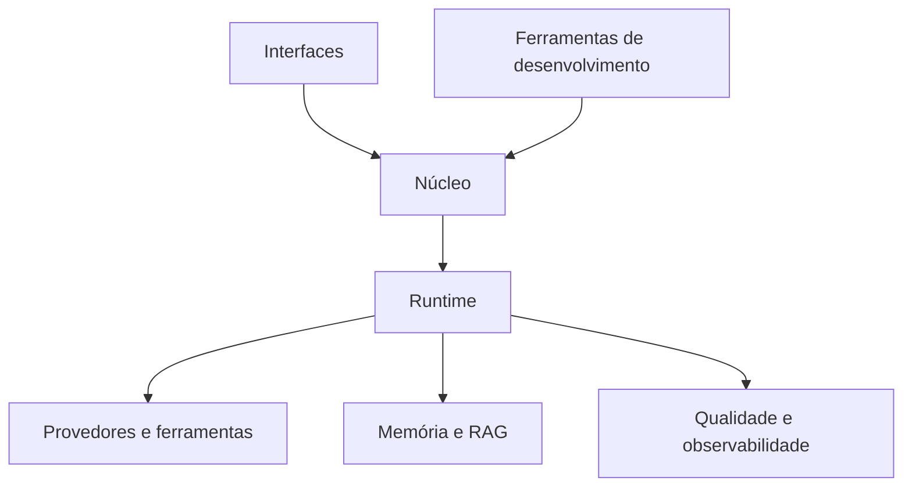

# 00 Hub - agentskit

> [!tldr] Em linguagem comum
> Repositório público de componentes para criar agentes: contratos centrais, provedores, ferramentas, memória, interfaces, avaliação e ferramentas de desenvolvimento.

← [[Camada - Framework OSS]]

## Para que existe e quem usa

O monorepo publica pacotes npm para equipes que constroem agentes e inclui documentação e exemplos. O workspace pnpm divide `packages/*` e `apps/*`; a lista completa de aplicações existentes está em `apps/`.

## Grupos

| Nota | Cobertura |
|---|---|
| [[00 Grupo - agentskit - Núcleo]] | 5 pacotes |
| [[00 Grupo - agentskit - Provedores e ferramentas]] | 6 pacotes |
| [[00 Grupo - agentskit - Memória e RAG]] | 2 pacotes |
| [[00 Grupo - agentskit - Interfaces]] | 8 pacotes |
| [[00 Grupo - agentskit - Qualidade e observabilidade]] | 4 pacotes |
| [[00 Grupo - agentskit - Ferramentas de desenvolvimento]] | 2 pacotes |
| [[00 Grupo - agentskit - Sites e serviços]] | 5 apps |
| [[00 Grupo - agentskit - Exemplos]] | 14 apps |

## Fluxos

| Nota | Jornada |
|---|---|
| [[AgentsKit - Copiar agente do Registry]] | fluxo |
| [[AgentsKit - Executar um agente]] | fluxo |
| [[AgentsKit - Pergunta com fontes]] | fluxo |

## Decisões e guias

- [[00 Decisões - agentskit]] — ADRs em `docs/architecture/adrs/`.
- [[AgentsKit - Executar um agente]] — runtime e ferramentas.
- [[AgentsKit - Pergunta com fontes]] — fluxo Ask e recuperação.
- [[AgentsKit - Copiar agente do Registry]] — CLI e catálogo.
- Guias: [[Criar um pacote]], [[Adicionar um adapter de provedor]], [[Adicionar um exemplo]], [[Rodar a documentação]], [[Publicar no npm com Changesets]].
- Auditoria desta documentação: [[Auditoria - agentskit]].

## Arquitetura resumida

## Como navegar como agente

Antes de alterar um pacote, leia seu `CONVENTIONS.md`, o handoff correspondente em `.doc-bridge/index.json` e as fontes humanas indicadas. O handoff fornece `startHere`, `editRoots` e checks; a CLI não pôde ser consultada porque o ambiente não tem `pnpm`.

> [!info]- Detalhe técnico
> - `pnpm-workspace.yaml:1` — raízes do workspace.
> - `package.json:1` — scripts do monorepo.
> - `doc-bridge.config.json:1` e `.doc-bridge/index.json` — configuração e snapshot de handoffs.
