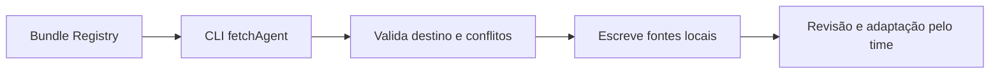

# AgentsKit - Copiar agente do Registry

> [!tldr] Em linguagem comum
> O desenvolvedor escolhe um agente pronto e o CLI copia seu código para o projeto. Depois da cópia, o time pode ler e adaptar os arquivos sem depender de um runtime Registry.

← [[00 Hub - agentskit]]

## Passo a passo

| Passo | O que acontece | Quem atua |
|---|---|---|
| Catálogo | Fornece metadados e arquivos empacotados. | [[00 Hub - agentskit-registry]] |
| CLI | Busca bundle hospedado; há fallback para fontes GitHub. | [[agentskit-cli]] |
| Checagem | Confere agente instalável, caminhos e conflitos antes de escrever. | [[agentskit-cli]] |
| Projeto | Recebe fontes em agents/<id>; o desenvolvedor escolhe dependências e provedor. | [[agentskit-runtime]] |

## Limites e dados

A pré-checagem evita deixar uma instalação pela metade por conflito de destino conhecido. As escritas são sequenciais: a função não implementa rollback de falha de disco durante a gravação. Portanto, a palavra “transactional” dos docs do Registry não deve ser interpretada como uma transação de filesystem com rollback garantido.

> [!info]- Detalhe técnico
> - `agentskit/packages/cli/src/registry.ts:142` — fetchAgent e fallback
> - `agentskit/packages/cli/src/registry.ts:225` — addAgent: destinos e gravação
> - `agentskit/packages/cli/src/registry.ts:242` — pré-checagem de todos os arquivos antes da primeira escrita
