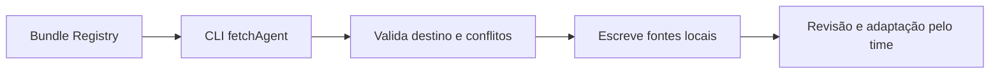

# AgentsKit - Copiar agente do Registry

> [!tldr] Em linguagem comum
> O desenvolvedor escolhe um agente pronto e o CLI copia seu código para o projeto. Depois da cópia, o time pode ler e adaptar os arquivos sem depender de um runtime Registry.

← [[00 Hub - agentskit]]

## Passo a passo

| Passo | O que acontece | Quem atua |
|---|---|---|
| Catálogo | Fornece metadados e arquivos empacotados. | [[agentskit-registry]] |
| CLI | Busca o bundle hospedado; se falhar, usa as fontes no GitHub (`fetchAgent`). | [[agentskit-cli]] |
| Checagem | Confere se o agente é instalável, os caminhos e os conflitos antes de escrever (`addAgent`). | [[agentskit-cli]] |
| Projeto | Recebe as fontes em `agents/<id>`; o desenvolvedor escolhe dependências e provedor. | [[agentskit-runtime]] |

## Limites e dados

A pré-checagem evita deixar uma instalação pela metade por conflito de destino conhecido. As escritas são sequenciais, e o código não tem rollback de falha de disco durante a gravação. Por isso, a palavra "transactional" dos docs do Registry não deve ser lida como transação de sistema de arquivos com rollback garantido.

> [!info]- Detalhe técnico
> - `packages/cli/src/registry.ts:141-142` — `fetchAgent`: bundle hospedado primeiro, depois o GitHub bruto.
> - `packages/cli/src/registry.ts:224-230` — `addAgent`: destino dentro de `agents/`, sem symlink nos ancestrais.
> - `packages/cli/src/registry.ts:241-244` — pré-checagem de cada arquivo antes da primeira escrita.
