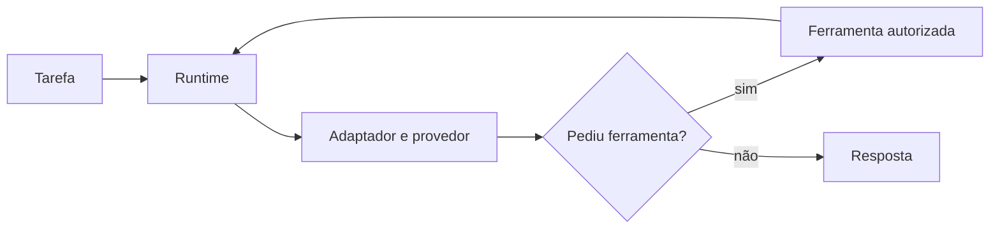

# AgentsKit - Executar um agente

> [!tldr] Em linguagem comum
> O usuário fornece uma tarefa; o agente consulta o modelo, executa ferramentas permitidas e repete até entregar a resposta ou atingir um limite.

← [[00 Hub - agentskit]]

## Passo a passo

| Passo | O que acontece | Quem atua |
|---|---|---|
| Aplicação | Chama `createRuntime(config).run(task, options)`; escolhe adaptador, ferramentas, instruções e limites. | [[agentskit-runtime]] |
| Laço | Monta mensagens, consome streaming e recolhe chamadas de ferramentas. Sem chamadas de ferramenta, o laço termina. | [[agentskit-core]] |
| Provedor | Traduz pedido e resposta para a API escolhida. | [[agentskit-adapters]] |
| Ferramentas | Executa chamadas e devolve resultados para o próximo passo. | [[agentskit-tools]] |
| Saída | Retorna conteúdo, mensagens e uso; observadores podem registrar os eventos. | [[agentskit-observability]] |

## Limites e dados

O runner (`createRuntime`) oferece cancelamento e limite de passos. O controlador de chat (`createChatController`) é outra entrada, que o código deixa para os bindings de interface. Memória, observadores e ferramentas são opcionais. Os dados enviados ao provedor dependem da composição feita pela aplicação.

> [!info]- Detalhe técnico
> - `packages/runtime/src/runner.ts:96` — `createRuntime`, com os limites do laço.
> - `packages/runtime/src/runner.ts:304-305` — sem chamadas de ferramenta, o agente termina (`break`).
> - `packages/core/src/controller.ts:27` — `createChatController`, controlador de conversa separado do runner.
