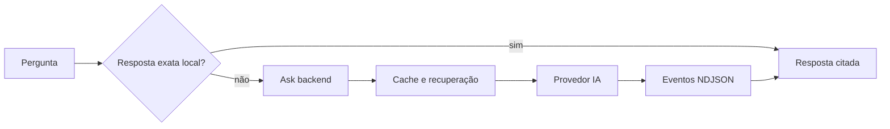

# AgentsKit - Pergunta com fontes

> [!tldr] Em linguagem comum
> Uma pessoa pergunta no site. Uma resposta exata pode sair do navegador; quando é preciso interpretar a pergunta, o serviço Ask busca material e transmite uma resposta com fontes.

← [[00 Hub - agentskit]]

## Passo a passo

| Passo | O que acontece | Quem atua |
|---|---|---|
| Navegador | Widget e conhecimento determinístico evitam chamada remota para fatos exatos. | [[chat]] |
| Site | Docs e Registry escolhem o corpus e o endpoint. | [[agentskit-registry]] |
| Servidor | Recebe /v1/ask, aplica limites e escolhe o handler do corpus. | [[agentskit-ask-backend]] |
| Busca e geração | Consulta o corpus, monta contexto e transmite eventos NDJSON. | [[agentskit-rag]] |
| Persistência | Cache de resposta e recuperação em memória e Redis/Upstash opcionais. | [[agentskit-ask-backend]] |

## Limites e dados

O backend Hono roda de forma persistente no deploy Railway documentado. O índice de docs e fontes remotas alimentam corpora; não se deve confundir este backend concreto com a interface genérica de chat-server. `OPENROUTER_API_KEY`, `REDIS_URL` e as variáveis `UPSTASH_REDIS_REST_*` são configuração, não evidência de serviços ativos. O cache não é a implementação do pacote memory; é código próprio do app.

> [!info]- Detalhe técnico
> - `agentskit/apps/ask-backend/src/server.ts:183` — cache e configuração de corpora
> - `agentskit/apps/ask-backend/src/server.ts:237` — CORS, limites e rotas
> - `agentskit/apps/ask-backend/src/ask/handler.ts:183` — pipeline do handler
> - `agentskit/apps/ask-backend/src/ask/handler.ts:394` — done e gravação de cache
> - `agentskit/railway.json:1` — Docker, /health e uma réplica
