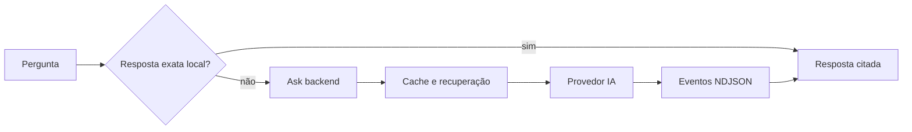

# AgentsKit - Pergunta com fontes

> [!tldr] Em linguagem comum
> Uma pessoa pergunta no site. Uma resposta exata pode sair do navegador; quando é preciso interpretar a pergunta, o serviço Ask busca material e transmite uma resposta com fontes.

← [[00 Hub - agentskit]]

## Passo a passo

| Passo | O que acontece | Quem atua |
|---|---|---|
| Navegador | Decide se a resposta exata pode vir do conhecimento local, sem chamada remota. A implementação do widget não está neste repositório. | (fora do repositório) |
| Site | Docs e Registry escolhem o corpus e o endpoint. | [[agentskit-registry]] |
| Servidor | Recebe `/v1/*`, aplica CORS e limites e escolhe o handler do corpus. | [[agentskit-ask-backend]] |
| Busca e geração | Consulta o corpus, monta o contexto e transmite eventos NDJSON. | [[agentskit-rag]] |
| Persistência | Cache de resposta e limite de requisições em memória, com Redis ou Upstash opcionais. | [[agentskit-ask-backend]] |

## Limites e dados

O backend roda como serviço persistente no Railway, com uma réplica e verificação de saúde em `/health` (`railway.json:7-13`). Variáveis de configuração, verificadas em código: `OPENROUTER_API_KEY` (obrigatória, `apps/ask-backend/src/server.ts:37-39`), `ASK_CACHE_ENABLED` (`server.ts:183`), `ASK_CORS_ORIGINS` (`server.ts:235`), `REDIS_URL` e `ASK_REDIS_URL` (`apps/ask-backend/src/ask/rate-limit.ts:75`), e `UPSTASH_REDIS_REST_URL` e `UPSTASH_REDIS_REST_TOKEN` (`apps/ask-backend/src/ask/cache.ts:192-193`). Ter o nome na configuração não prova que o serviço está ativo. O cache de resposta é código do próprio app, não o pacote `@agentskit/memory`.

> [!info]- Detalhe técnico
> - `apps/ask-backend/src/server.ts:183` — `ASK_CACHE_ENABLED` e criação do cache.
> - `apps/ask-backend/src/server.ts:237` — CORS e rotas `/v1/*`.
> - `apps/ask-backend/src/ask/handler.ts:183` — `createAskHandler`, o pipeline do handler.
> - `apps/ask-backend/src/ask/handler.ts:394-395` — evento `done` e gravação do cache.
> - `railway.json:1` — Dockerfile, `/health` e uma réplica.
