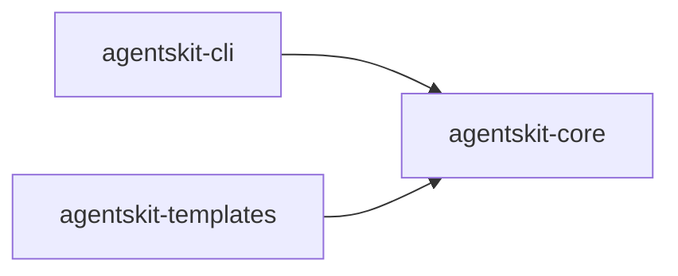

# 00 Grupo - agentskit - Ferramentas de desenvolvimento

> [!tldr] Em linguagem comum
> Este grupo reúne `@agentskit/cli`, `@agentskit/templates` para cobrir uma área do toolkit.

← [[00 Hub - agentskit]]

## Responsabilidade

O grupo organiza pacotes por responsabilidade funcional e facilita a navegação para agentes. Cada pacote tem handoff, raízes de edição e checks no índice Doc Bridge versionado; os fatos da matriz foram conferidos nos manifests locais.

## Pacotes e relações internas

| Nota | Pacote | Raiz |
|---|---|---|
| [[agentskit-cli]] | `@agentskit/cli` | `packages/cli` |
| [[agentskit-templates]] | `@agentskit/templates` | `packages/templates` |

Não há dependência entre `@agentskit/cli` e `@agentskit/templates` nos manifests: a raiz do monorepo é o único `package.json` que declara `@agentskit/templates` (`package.json:93`).

## Dependências de outros grupos

Verificadas nos manifests de `packages/cli/package.json:52-62` e `packages/templates/package.json:50`.

| Grupo | Relação |
|---|---|
| [[00 Grupo - agentskit - Núcleo]] | `@agentskit/core` (cli e templates), `@agentskit/net` e `@agentskit/runtime` (cli). |
| [[00 Grupo - agentskit - Provedores e ferramentas]] | `@agentskit/adapters`, `@agentskit/integrations`, `@agentskit/skills` e `@agentskit/tools` (cli). |
| [[00 Grupo - agentskit - Memória e RAG]] | `@agentskit/memory` e `@agentskit/rag` (cli). |
| [[00 Grupo - agentskit - Interfaces]] | `@agentskit/ink` e `@agentskit/cross-platform` (cli). |
| [[00 Grupo - agentskit - Qualidade e observabilidade]] | Nenhuma dependência encontrada nos manifests. |
| [[00 Grupo - agentskit - Ferramentas de desenvolvimento]] | Nenhuma dependência de outro pacote do grupo. |

## ADRs

Consulte [[00 Decisões - agentskit]] para contratos e decisões que afetam os pacotes deste grupo.

## Entradas para agentes

Para editar um pacote, abra sua nota, siga `startHere`, leia `CONVENTIONS.md` e execute os comandos `checks` do handoff. Os checks não foram executados neste ambiente porque `pnpm` está ausente. Registro do grupo: `.doc-bridge/index.json`.

> [!info]- Detalhe técnico
> Relações internas: dependências `@agentskit/*` encontradas nos manifests listados em `fontes`; detalhes dos contratos e exemplos estão nas notas individuais.
