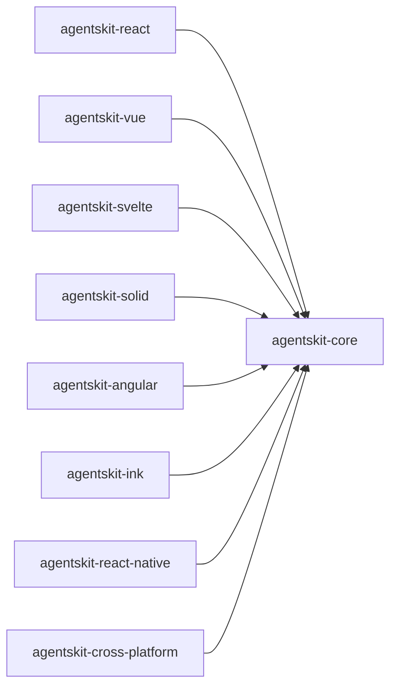

# 00 Grupo - agentskit - Interfaces

> [!tldr] Em linguagem comum
> Este grupo reúne `@agentskit/react`, `@agentskit/vue`, `@agentskit/svelte`, `@agentskit/solid`, `@agentskit/angular`, `@agentskit/ink`, `@agentskit/react-native`, `@agentskit/cross-platform` para cobrir uma área do toolkit.

← [[00 Hub - agentskit]]

## Responsabilidade

O grupo organiza pacotes por responsabilidade funcional e facilita a navegação para agentes. Cada pacote tem handoff, raízes de edição e checks no índice Doc Bridge versionado; os fatos da matriz foram conferidos nos manifests locais.

## Pacotes e relações internas

Nenhum pacote deste grupo depende de outro pacote deste grupo: a única dependência interna declarada nos manifests é `@agentskit/core` (`packages/*/package.json`, campo `dependencies`, valor `workspace:*`).

| Nota | Pacote | Raiz |
|---|---|---|
| [[agentskit-react]] | `@agentskit/react` | `packages/react` |
| [[agentskit-vue]] | `@agentskit/vue` | `packages/vue` |
| [[agentskit-svelte]] | `@agentskit/svelte` | `packages/svelte` |
| [[agentskit-solid]] | `@agentskit/solid` | `packages/solid` |
| [[agentskit-angular]] | `@agentskit/angular` | `packages/angular` |
| [[agentskit-ink]] | `@agentskit/ink` | `packages/ink` |
| [[agentskit-react-native]] | `@agentskit/react-native` | `packages/react-native` |
| [[agentskit-cross-platform]] | `@agentskit/cross-platform` | `packages/cross-platform` |

## Dependências de outros grupos

| Grupo | Relação (verificada nos manifests) |
|---|---|
| [[00 Grupo - agentskit - Núcleo]] | Dependência única de todos os pacotes deste grupo: `@agentskit/core` (`workspace:*`). |
| [[00 Grupo - agentskit - Provedores e ferramentas]] | Nenhum pacote deste grupo declara dependência de adapters ou ferramentas. Em sentido inverso, `@agentskit/cross-platform` é consumido por `packages/adapters` e `packages/tools` (ver [[agentskit-cross-platform]]). |
| [[00 Grupo - agentskit - Ferramentas de desenvolvimento]] | `@agentskit/ink` e `@agentskit/cross-platform` são declarados por `packages/cli` (`packages/cli/package.json:55` e `:54`). |
| [[00 Grupo - agentskit - Qualidade e observabilidade]] | `packages/eval` (`:111`) e `packages/observability` (`:118`) declaram `@agentskit/cross-platform`. |
| [[00 Grupo - agentskit - Memória e RAG]] | `packages/memory` declara `@agentskit/cross-platform` (`packages/memory/package.json:89`). `createInMemoryMemory` e `createLocalStorageMemory` vêm de `@agentskit/core`, não de um pacote de memória. |

Consumidores fora do grupo, verificados em `package.json`: `apps/example-ink` declara `@agentskit/ink`; `apps/docs-next`, `apps/example-react`, `apps/visual-react` e outros declaram `@agentskit/react`.

## ADRs

Consulte [[00 Decisões - agentskit]] para contratos e decisões que afetam os pacotes deste grupo.

## Entradas para agentes

Para editar um pacote, abra sua nota, siga `startHere`, leia `CONVENTIONS.md` e execute os comandos `checks` do handoff. Os checks não foram executados neste ambiente porque `pnpm` está ausente. Registro do grupo: `.doc-bridge/index.json`.

> [!info]- Detalhe técnico
> Relações internas: dependências `@agentskit/*` encontradas nos manifests listados em `fontes`; detalhes dos contratos e exemplos estão nas notas individuais.
