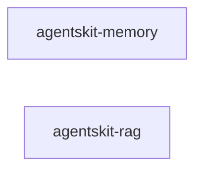

# 00 Grupo - agentskit - Memória e RAG

> [!tldr] Em linguagem comum
> Os dois pacotes que dão ao agente memória: `@agentskit/memory` guarda conversas e vetores, e `@agentskit/rag` busca os trechos de documento mais relevantes para cada pergunta.

← [[00 Hub - agentskit]]

## Responsabilidade

O grupo reúne armazenamento durável (`memory`) e recuperação de contexto (`rag`). Cada pacote tem handoff, raízes de edição e checks no índice Doc Bridge versionado. As relações abaixo foram conferidas nos `package.json` no commit `9f8d8551`.

## Pacotes e relações internas

Nenhum dos dois declara dependência do outro. Os dois dependem de `agentskit-core` e `agentskit-net`. O `rag` usa `VectorMemory` por injeção (`store`), não por pacote.

| Nota | Pacote | Raiz | Estabilidade |
|---|---|---|---|
| [[agentskit-memory]] | `@agentskit/memory` | `packages/memory` | beta (`packages/memory/package.json:104`) |
| [[agentskit-rag]] | `@agentskit/rag` | `packages/rag` | beta (`packages/rag/package.json:90`) |

## Dependências de outros grupos

| Grupo | Relação verificada |
|---|---|
| [[00 Grupo - agentskit - Núcleo]] | `core` e `net` são dependências dos dois pacotes. |
| [[00 Grupo - agentskit - Ferramentas de desenvolvimento]] | `packages/cli` declara os dois pacotes (busca em `package.json`, commit `9f8d8551`). |

Consumidores: `@agentskit/memory` é declarado por `apps/docs-next`, `apps/example-ink` e `packages/cli`. `@agentskit/rag` é declarado por `apps/ask-backend`, `apps/docs-next`, `apps/example-rag-chat` e `packages/cli`.

## ADRs

Consulte [[00 Decisões - agentskit]] para contratos e decisões que afetam os pacotes deste grupo.

## Entradas para agentes

Para editar um pacote, abra sua nota, siga `startHere`, leia `CONVENTIONS.md` e execute os comandos `checks` do handoff. Os checks não foram executados neste ambiente porque `pnpm` está ausente. Registro do grupo: `.doc-bridge/index.json`.

> [!info]- Detalhe técnico
> - `packages/memory/package.json:68-71` e `packages/rag/package.json:64-68` — dependências internas.
> - Dependentes por busca: `git grep -l '"@agentskit/memory": '` e `git grep -l '"@agentskit/rag": '` em `packages` e `apps`.
