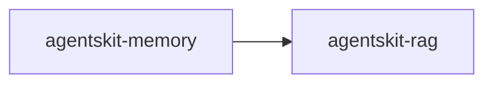

# 00 Grupo - agentskit - Memória e RAG

> [!tldr] Em linguagem comum
> Este grupo reúne `@agentskit/memory`, `@agentskit/rag` para cobrir uma área do toolkit.

← [[00 Hub - agentskit]]

## Responsabilidade

O grupo organiza pacotes por responsabilidade funcional e facilita a navegação para agentes. Cada pacote tem handoff, raízes de edição e checks no índice Doc Bridge versionado; os fatos da matriz foram conferidos nos manifests locais.

## Pacotes e relações internas

| Nota | Pacote | Raiz |
|---|---|---|
| [[agentskit-memory]] | `@agentskit/memory` | `packages/memory` |
| [[agentskit-rag]] | `@agentskit/rag` | `packages/rag` |

## Dependências de outros grupos

| Grupo | Relação |
|---|---|
| [[00 Grupo - agentskit - Núcleo]] | Contratos centrais usados por diversos pacotes do ecossistema. |
| [[00 Grupo - agentskit - Provedores e ferramentas]] | Fornece adaptadores, ferramentas e integrações quando declarado nos manifests. |
| [[00 Grupo - agentskit - Memória e RAG]] | Armazenamento e recuperação consumidos opcionalmente. |
| [[00 Grupo - agentskit - Interfaces]] | Bindings que conectam controladores às plataformas de UI. |
| [[00 Grupo - agentskit - Qualidade e observabilidade]] | Medição, observação e integrações de avaliação. |
| [[00 Grupo - agentskit - Ferramentas de desenvolvimento]] | CLI e templates para criação de projetos. |

## ADRs

Consulte [[00 Decisões - agentskit]] para contratos e decisões que afetam os pacotes deste grupo.

## Entradas para agentes

Para editar um pacote, abra sua nota, siga `startHere`, leia `CONVENTIONS.md` e execute os comandos `checks` do handoff. Os checks não foram executados neste ambiente porque `pnpm` está ausente. Registro do grupo: `.doc-bridge/index.json`.

> [!info]- Detalhe técnico
> Relações internas: dependências `@agentskit/*` encontradas nos manifests listados em `fontes`; detalhes dos contratos e exemplos estão nas notas individuais.
