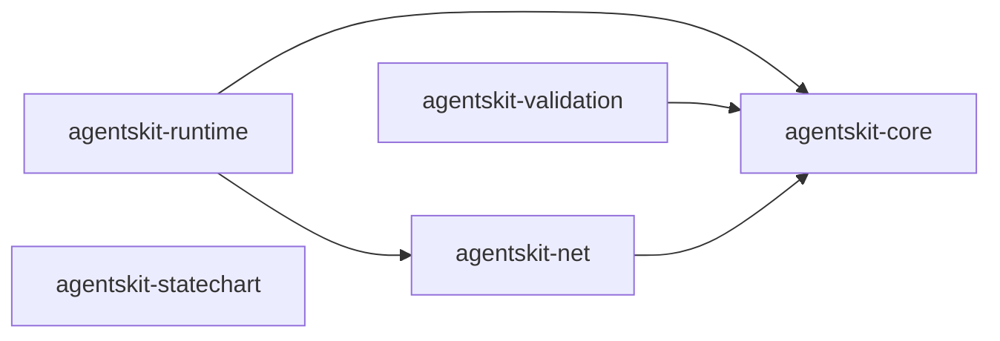

# 00 Grupo - agentskit - Núcleo

> [!tldr] Em linguagem comum
> Os cinco pacotes centrais do AgentsKit: o contrato básico (`core`), a execução de agentes (`runtime`), o estado de interação (`statechart`), a validação de argumentos (`validation`) e o HTTP seguro (`net`). Quase todo outro pacote do repositório depende de `core`.

← [[00 Hub - agentskit]]

## Responsabilidade

O grupo reúne os pacotes sem os quais os demais não funcionam. Cada pacote tem handoff, raízes de edição e checks no índice Doc Bridge versionado. As relações abaixo foram conferidas nos `package.json`.

## Pacotes e relações internas

| Nota | Pacote | Raiz | Estabilidade |
|---|---|---|---|
| [[agentskit-core]] | `@agentskit/core` | `packages/core` | stable (`packages/core/package.json:146`) |
| [[agentskit-runtime]] | `@agentskit/runtime` | `packages/runtime` | beta (`packages/runtime/package.json:67`) |
| [[agentskit-statechart]] | `@agentskit/statechart` | `packages/statechart` | beta (`packages/statechart/package.json:51`) |
| [[agentskit-validation]] | `@agentskit/validation` | `packages/validation` | beta, privado (`packages/validation/package.json:3`, `:53`) |
| [[agentskit-net]] | `@agentskit/net` | `packages/net` | beta (`packages/net/package.json:63`) |

`statechart` não tem dependência interna nem dependente declarado no repositório.

## Dependências de outros grupos

Relação inversa: pacotes de outros grupos dependem deste núcleo (busca em `package.json` de `packages` e `apps`, commit `9f8d8551`).

| Grupo | Dependentes de `@agentskit/core` (amostra) |
|---|---|
| [[00 Grupo - agentskit - Provedores e ferramentas]] | `adapters`, `integrations`, `mcp`, `sandbox`, `skills`, `tools` |
| [[00 Grupo - agentskit - Memória e RAG]] | `memory`, `rag` |
| [[00 Grupo - agentskit - Interfaces]] | `react`, `vue`, `svelte`, `solid`, `angular`, `ink`, `react-native` |
| [[00 Grupo - agentskit - Qualidade e observabilidade]] | `eval`, `eval-braintrust`, `observability`, `observability-langfuse` |
| [[00 Grupo - agentskit - Ferramentas de desenvolvimento]] | `cli`, `templates` |

`@agentskit/runtime` é declarado por `cli`, `mcp` e pelos apps de exemplo e documentação (ver [[agentskit-runtime]]).

## ADRs

Consulte [[00 Decisões - agentskit]] para contratos e decisões que afetam os pacotes deste grupo.

## Entradas para agentes

Para editar um pacote, abra sua nota, siga `startHere`, leia `CONVENTIONS.md` e execute os comandos `checks` do handoff. Os checks não foram executados neste ambiente porque `pnpm` está ausente. Registro do grupo: `.doc-bridge/index.json`.

> [!info]- Detalhe técnico
> - `packages/core/package.json:1`, `packages/runtime/package.json:1`, `packages/statechart/package.json:1`, `packages/validation/package.json:1`, `packages/net/package.json:1` — manifestos, dependências e campo `agentskit.stability`.
> - Dependentes por busca: `git grep -l '"@agentskit/core": '` e equivalentes para cada pacote, em `packages` e `apps`.
