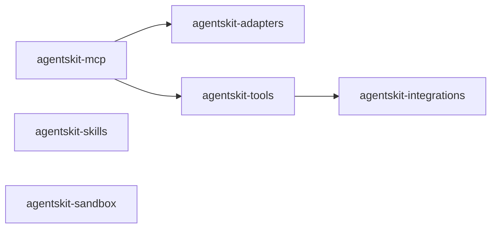

# 00 Grupo - agentskit - Provedores e ferramentas

> [!tldr] Em linguagem comum
> Os pacotes que dão ao agente acesso ao mundo: modelos de IA (`adapters`), serviços externos (`integrations`), ferramentas prontas (`tools`), a ponte MCP (`mcp`), personas (`skills`) e execução isolada de código (`sandbox`).

← [[00 Hub - agentskit]]

## Responsabilidade

O grupo reúne a camada que conecta o agente a fornecedores e ferramentas. Cada pacote tem handoff, raízes de edição e checks no índice Doc Bridge versionado. As relações abaixo foram conferidas nos `package.json` e em buscas por `git grep` no commit `9f8d8551`.

## Pacotes e relações internas

Relações com outros grupos, fora do diagrama: `adapters`, `tools` e `sandbox` dependem de `agentskit-cross-platform` (grupo Interfaces); `adapters`, `tools`, `integrations` e `mcp` dependem de `agentskit-net` e `agentskit-core` (grupo Núcleo). `skills` depende só de `core`. `sandbox` depende de `core` e `cross-platform`.

| Nota | Pacote | Raiz | Estabilidade |
|---|---|---|---|
| [[agentskit-adapters]] | `@agentskit/adapters` | `packages/adapters` | beta |
| [[agentskit-integrations]] | `@agentskit/integrations` | `packages/integrations` | beta |
| [[agentskit-mcp]] | `@agentskit/mcp` | `packages/mcp` | beta |
| [[agentskit-tools]] | `@agentskit/tools` | `packages/tools` | beta |
| [[agentskit-skills]] | `@agentskit/skills` | `packages/skills` | beta |
| [[agentskit-sandbox]] | `@agentskit/sandbox` | `packages/sandbox` | beta |

## Dependências de outros grupos

| Grupo | Relação verificada |
|---|---|
| [[00 Grupo - agentskit - Núcleo]] | `core` é dependência de todos os seis pacotes. `net` é dependência de `adapters`, `integrations`, `mcp` e `tools`. |
| [[00 Grupo - agentskit - Interfaces]] | `cross-platform` é dependência de `adapters`, `tools` e `sandbox`. |
| [[00 Grupo - agentskit - Ferramentas de desenvolvimento]] | `packages/cli` depende de `adapters`, `tools` e `skills` (busca em `package.json`, commit `9f8d8551`). |

Dependentes de `@agentskit/adapters` (10 manifestos, nota [[agentskit-adapters]]) e de `@agentskit/tools` (5) incluem o `apps/ask-backend`. O `@agentskit/mcp` não é declarado por nenhum manifesto do repositório. O `@agentskit/sandbox` é declarado só por `apps/docs-next`.

## ADRs

Consulte [[00 Decisões - agentskit]] para contratos e decisões que afetam os pacotes deste grupo.

## Entradas para agentes

Para editar um pacote, abra sua nota, siga `startHere`, leia `CONVENTIONS.md` e execute os comandos `checks` do handoff. Os checks não foram executados neste ambiente porque `pnpm` está ausente. Registro do grupo: `.doc-bridge/index.json`.

> [!question] Dúvida: onde vive a camada de integrações
> `packages/tools/CONVENTIONS.md:14` atribui as integrações a `@agentskit/tools/integrations`, mas os descritores estão em `@agentskit/integrations`, e `packages/tools/src/integrations/` é só uma camada de shims `@deprecated`. Ver a Dúvida em [[agentskit-tools]].

> [!info]- Detalhe técnico
> - Dependências por manifesto: `packages/*/package.json` em `dependencies` (não `devDependencies`), salvo onde indicado nas notas de pacote.
> - Dependentes por busca: `git grep -l '"@agentskit/<pacote>": '` em `packages` e `apps`.
