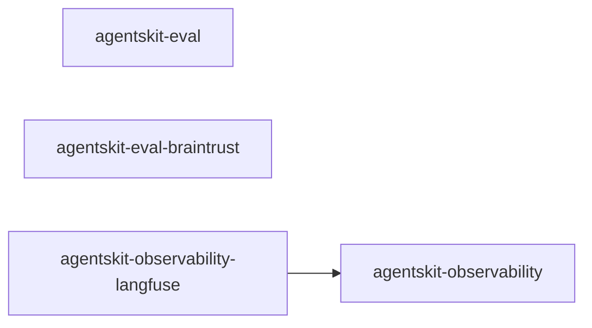

# 00 Grupo - agentskit - Qualidade e observabilidade

> [!tldr] Em linguagem comum
> Este grupo reúne `@agentskit/eval`, `@agentskit/eval-braintrust`, `@agentskit/observability`, `@agentskit/observability-langfuse` para cobrir uma área do toolkit.

← [[00 Hub - agentskit]]

## Responsabilidade

O grupo organiza pacotes por responsabilidade funcional e facilita a navegação para agentes. Cada pacote tem handoff, raízes de edição e checks no índice Doc Bridge versionado; os fatos da matriz foram conferidos nos manifests locais.

## Pacotes e relações internas

| Nota | Pacote | Raiz |
|---|---|---|
| [[agentskit-eval]] | `@agentskit/eval` | `packages/eval` |
| [[agentskit-eval-braintrust]] | `@agentskit/eval-braintrust` | `packages/eval-braintrust` |
| [[agentskit-observability]] | `@agentskit/observability` | `packages/observability` |
| [[agentskit-observability-langfuse]] | `@agentskit/observability-langfuse` | `packages/observability-langfuse` |

## Dependências de outros grupos

| Grupo | Relação (verificada nos manifests) |
|---|---|
| [[00 Grupo - agentskit - Núcleo]] | `@agentskit/core` é dependência dos quatro pacotes deste grupo. `@agentskit/net` é dependência de `observability` (`packages/observability/package.json:80`). |
| [[00 Grupo - agentskit - Interfaces]] | `@agentskit/cross-platform` é dependência de `eval` (`packages/eval/package.json:111`) e de `observability` (`packages/observability/package.json:118`); ver [[agentskit-cross-platform]]. |
| [[00 Grupo - agentskit - Provedores e ferramentas]] | Nenhuma dependência encontrada nos manifests. |
| [[00 Grupo - agentskit - Memória e RAG]] | Nenhuma dependência encontrada nos manifests. |
| [[00 Grupo - agentskit - Ferramentas de desenvolvimento]] | Nenhuma dependência encontrada nos manifests. |

Dentro do grupo: `@agentskit/observability-langfuse` depende de `@agentskit/observability` (`packages/observability-langfuse/package.json:45`), como mostra o diagrama.

Consumidores fora do grupo, verificados em `package.json`: `@agentskit/eval` é declarado por `apps/docs-next` (`apps/docs-next/package.json:39`), `apps/example-dspy` (`apps/example-dspy/package.json:14`) e a raiz do monorepo (`package.json:89`); `@agentskit/observability` é declarado por `apps/docs-next` (`apps/docs-next/package.json:42`) e pela raiz (`package.json:90`).

## ADRs

Consulte [[00 Decisões - agentskit]] para contratos e decisões que afetam os pacotes deste grupo.

## Entradas para agentes

Para editar um pacote, abra sua nota, siga `startHere`, leia `CONVENTIONS.md` e execute os comandos `checks` do handoff. Os checks não foram executados neste ambiente porque `pnpm` está ausente. Registro do grupo: `.doc-bridge/index.json`.

> [!info]- Detalhe técnico
> Relações internas: dependências `@agentskit/*` encontradas nos manifests listados em `fontes`; detalhes dos contratos e exemplos estão nas notas individuais.
