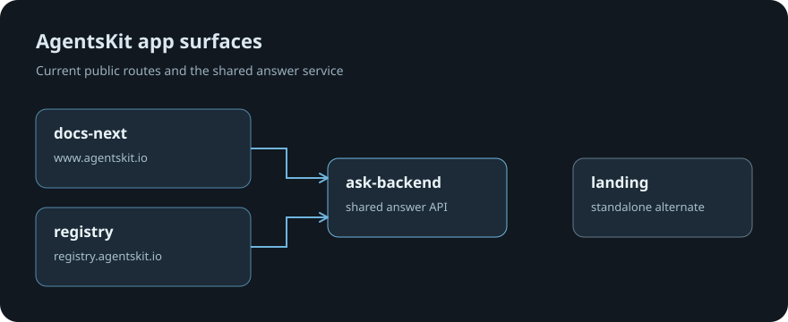

# landing

Profile: <code>public-app</code>

## Verified proof

- App package lives at `apps/landing`.
- Root claims: [ecosystem-claims.json](../../ecosystem-claims.json)



## Install / run

<!-- readme-command:install -->
```bash
pnpm --filter ./apps/landing build
```

## Quick start

<!-- readme-example:quickstart -->
```bash
pnpm --filter ./apps/landing build
```

## Maturity and compatibility

- Private monorepo app surface; ships with AgentsKit docs/product properties.
- **Node.js 20+** and **TypeScript**

## Contributing

See [CONTRIBUTING.md](../../CONTRIBUTING.md) and [LICENSE](../../LICENSE).

## Ecosystem

- [AgentsKit](https://www.agentskit.io)
- [Registry](https://registry.agentskit.io)
- [Playbook](https://playbook.agentskit.io)

**Tags:** `agentskit` · `typescript`

# @agentskit/landing

Profile: <code>public-app</code>

Standalone Next.js 16 landing page for AgentsKit — issue [#230](https://github.com/AgentsKit-io/agentskit/issues/230) (P0.19).

Independent from `apps/docs-next`. The Cloudflare Worker `agentskit-docs`, built from `apps/docs-next` with vinext, serves the public domain and `/docs`; this standalone app is not mapped to `www.agentskit.io`. Treat `apps/docs-next` as the production owner until routing is deliberately changed. All `LINKS.docs` URLs use the `/docs` path.

## Stack

- Next.js 16 (App Router, standalone output)
- React 19
- Tailwind CSS v4 (PostCSS plugin)
- Zero dependencies on workspace packages — pure marketing surface, no MDX, no SDK examples that drag the agent runtime into the bundle.

## Develop

```bash
pnpm --filter @agentskit/landing dev
```

Opens on http://127.0.0.1:4180.

## Build / start

```bash
pnpm --filter @agentskit/landing build
pnpm --filter @agentskit/landing start
```

## Structure

```
app/
  globals.css           # Tailwind + design tokens
  layout.tsx            # root layout + metadata
  page.tsx              # composition only
  _components/
    header.tsx
    hero.tsx
    code-sample.tsx
    pillars.tsx
    packages-grid.tsx
    install-cta.tsx
    footer.tsx
    links.ts            # all external URLs (single source)
public/
  favicon.svg
```

Add a new section by writing it under `app/_components/` and dropping it into `app/page.tsx`. Keep the file count low; this surface is intentionally narrow.

## Design tokens

Defined in `app/globals.css` under `@theme`:

| token | value |
|---|---|
| `--color-bg` | `#0a0a0b` |
| `--color-bg-soft` | `#131316` |
| `--color-fg` | `#f5f5f7` |
| `--color-accent` | `#7c5cff` |
| `--color-accent-soft` | `#a690ff` |

Mirror updates here into `apps/docs-next/styles/` if cross-surface visual consistency is needed.

## Deploy

- **Self-hosted** (Node server, Docker): set `NEXT_OUTPUT_STANDALONE=1` to switch Next to `output: 'standalone'`.
- This app has no dedicated deploy configuration; the Cloudflare Worker built from `apps/docs-next` serves the public domain.
